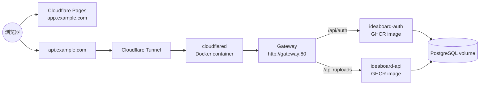
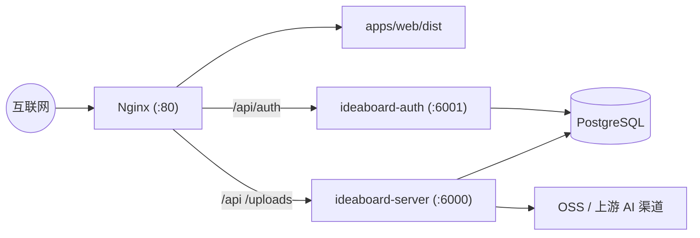
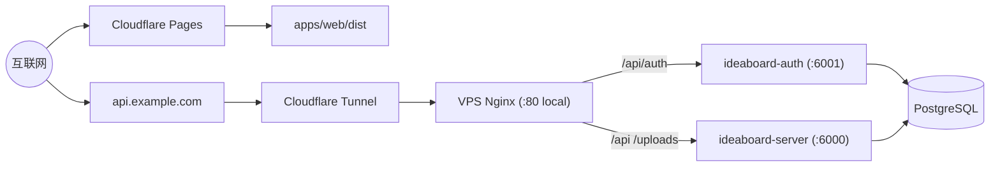

# <div align="center">IdeaBoard Linux 部署手册</div>

<p align="center">
  <strong>适用于标准 Linux 服务器的部署、升级与回滚手册。</strong>
</p>

<p align="center">
  目标运行形态：<code>Cloudflare Pages + GHCR + Docker Compose + Cloudflare Tunnel</code>
</p>

<p align="center">
  <code>私有</code>
  <code>闭源</code>
  <code>内部运维文档</code>
</p>

<p align="center">
  <a href="#deployment-profile">部署概览</a> ·
  <a href="#recommended-docker">推荐 Docker 部署</a> ·
  <a href="#release-artifact">发布产物</a> ·
  <a href="#install-flow">安装流程</a> ·
  <a href="#runtime-config">运行配置</a> ·
  <a href="#upgrade-and-rollback">升级回滚</a>
</p>


> [!IMPORTANT]
> 本文档仅供 IdeaBoard 授权成员在内部部署与运维场景下使用。项目为闭源私有项目，未经授权不得复制、分发或对外传播。
>
> 账号安全与业务运维的职责边界请同时参考 [docs/AUTH_OPERATION_RUNBOOK.md](./docs/AUTH_OPERATION_RUNBOOK.md)；PostgreSQL backup / restore 的密钥材料处理规则见 [docs/data-protection-runbook.md](./docs/data-protection-runbook.md)。

<a id="deployment-profile"></a>
## 部署概览

本文档适用于 `Linux amd64/arm64` 服务器。当前优先推荐 `Cloudflare Pages + GHCR + Docker Compose + Cloudflare Tunnel`，保留 `Nginx + systemd + PostgreSQL + Better Auth Node Service` 作为传统部署方式。

### 推荐拓扑



### 传统拓扑




### 传统发布包约定

| 项目 | 当前约定 |
|------|----------|
| 部署根目录 | `/opt/ideaboard` |
| systemd 服务名 | `ideaboard`、`ideaboard-auth` |
| Nginx 配置名 | `ideaboard.conf` |
| 后端监听端口 | `6000` |
| 认证服务监听端口 | `6001` |
| 发布包名 | `ideaboard-bundle-<tag>-linux-amd64.tar.gz` |
| API 可执行文件 | `apps/api/ideaboard-server` |
| Auth 入口文件 | `apps/auth/dist/index.js` |

### Cloudflare Pages + Cloudflare Tunnel + VPS 拓扑

推荐的混合部署方式：Cloudflare Pages 托管前端，Cloudflare Tunnel 暴露后端 API 域名，VPS 只在本机运行后端、认证服务与 PostgreSQL。



Pages 项目建议配置：

| 项目 | 值 |
|------|----|
| Root directory | `apps/web` |
| Build command | `npm run build` |
| Build output directory | `dist` |
| Environment variable | `NODE_VERSION=22.22.2` |
| Environment variable | `VITE_API_BASE_URL=https://api.example.com/api` |
| Environment variable | `VITE_AUTH_BASE_URL=https://api.example.com` |

前端默认从 `VITE_API_BASE_URL` 派生 `/uploads/*` 的访问域名；如需独立素材域名，可额外设置 `VITE_PUBLIC_ASSET_BASE_URL=https://assets.example.com`。

VPS 侧推荐使用本文的 Docker Compose stack 部署 API、Auth、PostgreSQL 与 Gateway，不再依赖 VPS 托管 `apps/web/dist`。Docker 生产环境至少同步：

```bash
# /opt/stacks/ideaboard/docker/.env
APP_BASE_URL=https://你的前端域名
API_BASE_URL=https://api.example.com
CLOUDFLARE_TUNNEL_TOKEN=Cloudflare Tunnel Docker token
```

Cloudflare Tunnel 使用 Docker connector。Cloudflare Public Hostname 配置：

```text
Hostname: api.example.com
Service: http://gateway:80
```

VPS 防火墙建议只开放 SSH；API 域名通过 compose 内的 `cloudflared` 到达 Gateway，无需把 `6000/6001/PostgreSQL` 暴露到公网。

<a id="recommended-docker"></a>

## 推荐 Docker 部署

推荐方式是 CI 构建镜像并推送到 GHCR，VPS 只拉取镜像和启动容器：

```text
GitHub Actions
  -> ghcr.io/<owner>/<repo>/ideaboard-api@sha256:<digest>
  -> ghcr.io/<owner>/<repo>/ideaboard-auth@sha256:<digest>
  -> ghcr.io/<owner>/<repo>/ideaboard-auth-migrate@sha256:<digest>

VPS
  -> ideaboard update
```

### 1. 构建并发布镜像

仓库已内置 [docker-images.yml](./.github/workflows/docker-images.yml)。触发方式：

- push 到 `main` / `master`
- push `v*` tag
- 在 GitHub Actions 手动运行 workflow，并可填写额外 `image_tag`

生产部署不要把 VPS 端 bootstrap 绑定到 `main`；请始终使用明确的发布 tag 或 commit SHA。镜像部署值必须使用 GitHub Actions 输出的 digest 引用。

镜像命名约定：

```text
ghcr.io/<github-owner>/<github-repo>/ideaboard-api@sha256:<digest>
ghcr.io/<github-owner>/<github-repo>/ideaboard-auth@sha256:<digest>
ghcr.io/<github-owner>/<github-repo>/ideaboard-auth-migrate@sha256:<digest>
```

#### 镜像供应链检查

发布路径会为每个镜像生成 CycloneDX SBOM artifact，使用 Grype 拦截 `high` 及以上漏洞，并用 Cosign keyless OIDC 对镜像 digest 签名。

Grype 的统一 triage 文件是仓库根目录 [`.grype.yaml`](./.grype.yaml)。新增例外时只加窄范围规则，例外原因和复查日期写在对应 PR 或 issue 里；优先升级基础镜像或依赖，不要直接放宽 workflow 的 `severity-cutoff`：

```yaml
ignore:
  - vulnerability: CVE-YYYY-NNNN
    fix-state: unknown
    package:
      name: package-name
      type: deb
```

`ideaboard update` 默认会在 pull 前执行 Cosign keyless 验签，VPS 必须先安装 `cosign`。未显式设置 `COSIGN_CERTIFICATE_IDENTITY_REGEXP` 时，脚本会从 `IDEABOARD_API_IMAGE` / `IDEABOARD_AUTH_IMAGE` / `IDEABOARD_AUTH_MIGRATE_IMAGE` 的 `ghcr.io/<owner>/<repo>/...` 自动派生签名身份，只接受同仓库 `docker-images.yml` workflow 的 branch/tag 发布；离线排障时才临时设置 `COSIGN_VERIFY=false`。手动验签示例：

```bash
cosign verify \
  --certificate-identity "https://github.com/<github-owner>/<github-repo>/.github/workflows/docker-images.yml@refs/heads/main" \
  --certificate-oidc-issuer "https://token.actions.githubusercontent.com" \
  "ghcr.io/<github-owner>/<github-repo>/ideaboard-api@sha256:<digest>"
```

### 2. 首次 VPS 初始化 + 部署

```bash
REF=v0.1.0
curl -fsSL \
  -H "Accept: application/vnd.github.raw" \
  "https://api.github.com/repos/Ericsunsk/IdeaBoard/contents/scripts/bootstrap-vps.sh?ref=${REF}" \
  -o /tmp/bootstrap-vps.sh
GITHUB_TOKEN=your-github-token bash /tmp/bootstrap-vps.sh --ref "${REF}"
```

把 `REF` 换成明确的发布 tag 或 commit SHA。强制重装可加 `IDEABOARD_FORCE=1`；脚本会备份旧目录并恢复 `docker/.env`。Bootstrap 会在部署前检查 `cosign`，除非你已经在 `docker/.env` 里显式设置 `COSIGN_VERIFY=false`。

至少修改：

- `APP_BASE_URL`
- `API_BASE_URL`
- `CLOUDFLARE_TUNNEL_TOKEN`
- `CLOUDFLARED_VERSION`
- `IDEABOARD_API_IMAGE`
- `IDEABOARD_AUTH_IMAGE`
- `IDEABOARD_AUTH_MIGRATE_IMAGE`
- `POSTGRES_PASSWORD`
- `AUTH_INTERNAL_KEY`
- `BETTER_AUTH_SECRET`
- `NATS_PASSWORD`

### 3. 后续部署 / 升级

```bash
ideaboard update
```

`ideaboard update` 会在执行 API / Auth migration 前自动导出 PostgreSQL backup 和 `api-uploads` tar，默认写到 `/opt/stacks/ideaboard-backups/`，文件名带时间戳，默认保留最近 5 份。Backup 或 deploy 后 Gateway 的 `/api/health`、`/api/auth/health` 或公网 `${API_BASE_URL}/api/health` health gate 失败都会中止部署并打印相关容器日志。

> [!IMPORTANT]
> PostgreSQL backup 包含 `api_account_secrets`、`storage_profile_secrets` 等密钥表，可能含有上游 API key、S3 access key/secret、endpoint 与 bucket 配置。`postgres-*.sql` 必须按 secret artifact 处理：建议加密落盘，只允许受控传输和最小必要人员访问；完成 restore 后按受影响范围轮换上游 API key 与对象存储凭据，并清理临时副本。

当前 Docker stack 只管理 PostgreSQL 数据库；`ideaboard update` 不会自动转换或导入其他数据库形态的数据。首次部署或切换部署形态前，请先确认目标 PostgreSQL 中已有需要保留的数据，或明确按空库初始化。

<a id="api-database-baseline"></a>

#### API 业务库 baseline

Go API 业务表使用单 baseline migration。空 PostgreSQL 库会在 API migration 或 API 启动时自动初始化业务 schema，并写入当前 baseline 版本 `20260609000000`。Docker 部署会先运行 `api-migrate`，再运行 Auth migration。

非空数据库不能直接套用该 baseline。若你从旧部署或其他形态迁入数据，标准做法是先导出需要保留的数据，再在空库上初始化当前 baseline，最后用受控脚本导入业务数据；不要手动修改 `schema_migrations` 绕过 baseline 校验。

当前 API migration 保护会拒绝三类风险状态：`schema_migrations` 里存在当前二进制不认识的历史版本；baseline 未应用但 schema 已经有 API-owned 业务表；baseline 已标记应用但当前 schema 缺少 baseline 业务表。Better Auth 的 `"user"`、`"session"`、`"account"`、`"verification"` 等认证表可以先存在，不计入 API baseline 冲突；不过标准部署顺序仍是 API baseline first、Better Auth migration second。CI 会用 PostgreSQL 17 执行 `go test ./internal/db/migrations -run TestMigrations -count=1`，覆盖 fresh replay、重复执行、Auth 表先存在、seed、trigger、constraint 和上述保护场景；同时会串行执行 `go run ./cmd migrate`、`npm run migrate:dist`，再重复一次，验证真实 API/Auth migration 顺序和幂等性。

常用运维：

```bash
ideaboard restart
ideaboard stop
ideaboard status
ideaboard logs
ideaboard delete --yes
```

`delete` 默认保留 Docker volumes；同时删除数据加 `--volumes`。

### 4. 初始化管理员

```bash
docker compose -f /opt/stacks/ideaboard/docker/compose.yml --env-file /opt/stacks/ideaboard/docker/.env run --rm \
  -e INIT_ADMIN_PASSWORD='your-strong-password' \
  api init-admin
```

### 5. Cloudflare Tunnel

Cloudflare Public Hostname 指向 compose 内部 Gateway：

```text
Hostname: api.example.com
Service: http://gateway:80
```

### 6. 验证

```bash
docker compose -f /opt/stacks/ideaboard/docker/compose.yml --env-file /opt/stacks/ideaboard/docker/.env ps
ideaboard smoke
curl http://127.0.0.1:8080/api/health
curl http://127.0.0.1:8080/api/auth/health
curl "${API_BASE_URL}/api/health"
curl http://127.0.0.1:8080/api/auth/get-session
```

`/api/auth/get-session` 未登录时返回未认证是正常的；关键是 Gateway 能转发到 Auth Service，不应出现连接失败。
`ideaboard smoke` 会检查 PostgreSQL、NATS JetStream、Gateway API/Auth health、River schema、默认 JetStream event stream，以及公网 `${API_BASE_URL}/api/health`。

### 7. 升级与回滚

升级到新镜像：

```bash
nano /opt/stacks/ideaboard/docker/.env
# 修改 IDEABOARD_API_IMAGE / IDEABOARD_AUTH_IMAGE / IDEABOARD_AUTH_MIGRATE_IMAGE，并保持 CLOUDFLARED_VERSION 为固定版本
ideaboard update
```

回滚时把三个 digest 镜像引用改回上一版，再执行：

```bash
ideaboard update
```

若新版本已执行 migration，先保留故障现场并确认最近 backup：

```bash
ls -lh /opt/stacks/ideaboard-backups/
docker compose -f /opt/stacks/ideaboard/docker/compose.yml --env-file /opt/stacks/ideaboard/docker/.env logs --tail=200 gateway api auth postgres nats
```

当前脚本不会自动 restore database。需要 DB 回滚时，先人工评估 migration 影响，再使用对应时间点的 backup 做受控恢复。数据库 backup 与 `api-uploads` tar 分别保留在同一备份目录下；其中 PostgreSQL backup 含密钥材料，恢复完成后必须执行凭据轮换计划。

数据保存在 Docker volumes：`postgres-data`、`nats-data`、`api-uploads`。不要使用 `docker compose down -v`，除非你明确要删除生产数据。

<a id="release-artifact"></a>

## 发布产物

标准发布包由以下脚本生成：

```bash
./scripts/package-deploy.sh
```

产物结构示例：

```text
release/v0.1.0/ideaboard-bundle-v0.1.0-linux-amd64/
├── apps/
│   ├── api/
│   │   ├── ideaboard-server
│   │   ├── uploads/
│   │   └── .env.example
│   ├── auth/
│   │   ├── dist/
│   │   ├── package.json
│   │   ├── package-lock.json
│   │   └── .env.example
│   └── web/
│       └── dist/
├── deploy/
│   ├── nginx/
│   │   └── ideaboard.conf
│   └── systemd/
│       ├── ideaboard.service
│       └── ideaboard-auth.service
├── docs/
│   ├── AUTH_OPERATION_RUNBOOK.md
│   ├── architecture-constraints.md
│   └── assets/
├── docker/
│   └── README.md
├── README.md
├── DEVELOPMENT.md
├── SYSTEM_PROMPT.md
├── CHANGELOG.md
└── DEPLOYMENT.md
```


## 前置条件

服务器建议满足：

- 系统：`Linux amd64`
- 端口：`80`
- 软件：`nginx`、`postgresql`、`nodejs >= 22.18`、`npm`、`tar`

Ubuntu / Debian 参考安装命令：

```bash
sudo apt update
sudo apt install -y nginx postgresql postgresql-client nodejs npm
```

> [!NOTE]
> 如果发行版仓库里的 Node.js 版本低于 22.18，请通过 NodeSource、nvm 或你的标准运维镜像安装 Node.js 22.18+。

<a id="install-flow"></a>

## 安装流程

### 1. 下载并校验发布包

```bash
ssh root@你的服务器IP
cd /root
TAG=v0.1.0
BUNDLE="ideaboard-bundle-${TAG}-linux-amd64.tar.gz"
curl -L -o "$BUNDLE" \
  "https://github.com/Ericsunsk/IdeaBoard/releases/download/${TAG}/${BUNDLE}"
sha256sum "$BUNDLE"
```

校验值以 GitHub Release 页面中的 `SHA256SUMS.txt` 为准。

### 2. 解压到部署目录

推荐目录结构：

```text
/opt/ideaboard/
├── apps/
│   ├── api/
│   ├── auth/
│   └── web/
├── deploy/
├── logs/
└── releases/
```

执行：

```bash
mkdir -p /opt/ideaboard/releases /opt/ideaboard/logs
cd /opt/ideaboard/releases
tar -xzf "/root/${BUNDLE}"
RELEASE_DIR="/opt/ideaboard/releases/ideaboard-bundle-${TAG}-linux-amd64"

mkdir -p /opt/ideaboard/apps /opt/ideaboard/deploy
cp -R "${RELEASE_DIR}/apps/." /opt/ideaboard/apps/
cp -R "${RELEASE_DIR}/deploy/." /opt/ideaboard/deploy/
```

> [!IMPORTANT]
> 上面的覆盖步骤会合并复制新版本文件。不要顺手删除已有的 `.env`、上传目录或数据库数据。

### 3. 创建 systemd 运行用户并校准目录权限

首次部署建议执行：

```bash
id -u ideaboard >/dev/null 2>&1 || useradd --system --home /opt/ideaboard --shell /usr/sbin/nologin ideaboard
chown -R ideaboard:ideaboard /opt/ideaboard/apps /opt/ideaboard/deploy /opt/ideaboard/logs
```

说明：

- `ideaboard` 为 systemd 服务默认运行用户（非 root）。
- 升级时请保留该用户与目录权限设置，避免服务因权限不足启动失败。

### 4. 准备数据库

#### PostgreSQL

```bash
sudo -u postgres psql
```

```sql
CREATE USER ideaboard WITH PASSWORD '请替换为强密码';
CREATE DATABASE ideaboard OWNER ideaboard;
\c ideaboard
GRANT ALL PRIVILEGES ON DATABASE ideaboard TO ideaboard;
```

业务 schema 由 Go API 启动时按 [API 业务库 baseline](#api-database-baseline) 初始化；Auth 服务表由后续 `npm run migrate:dist` 维护。源码部署同样不要手写业务 DDL，非空库迁入前先确认 reset、restore 或受控导入策略。

<a id="runtime-config"></a>

## 运行配置

### 1. 配置后端环境变量

```bash
cp /opt/ideaboard/apps/api/.env.example /opt/ideaboard/apps/api/.env
nano /opt/ideaboard/apps/api/.env
```

部署时至少确认：

- `DB_HOST/DB_PORT/DB_USER/DB_PASSWORD/DB_NAME`
- `APP_ENV=production`（生产环境必须显式设置）
- `APP_PORT=6000`
- `APP_HOST=127.0.0.1`（建议反向代理场景启用）
- `APP_CORS_ALLOWED_ORIGINS`（Pages + API 独立域名时填写正式前端源，例如 `https://app.example.com`）
- `APP_PUBLIC_BASE_URL`（正式前端地址，用于生成分享链接，例如 `https://app.example.com`）
- `APP_PUBLIC_ASSET_BASE_URL`（正式素材/API 地址，用于 `/uploads/*` 与上游模型可访问图片，例如 `https://api.example.com`）
- `AUTH_SERVICE_BASE_URL=http://127.0.0.1:6001`
- `AUTH_INTERNAL_KEY`（API 与 Auth 服务共用的 internal endpoint 保护密钥，且不能使用 `replace-with-*` 占位值）

> 说明：`APP_BASE_URL`、`API_BASE_URL` 仍然是 docker compose / deploy 层的输入；API 运行时实际读取的是 `APP_PUBLIC_BASE_URL` 和 `APP_PUBLIC_ASSET_BASE_URL`。

建议：

- 不要在生产环境继续使用本地开发默认账号
- 若前面有 Nginx / 其他反向代理，建议设置 `APP_HOST=127.0.0.1`
- 生产环境请固定设置 `APP_ENV=production`，不要依赖默认值；发布包 systemd 已设置该值，不要在 `.env` 中写回 `development`
- `AUTH_INTERNAL_KEY` 建议使用足够长的随机字符串，并只在 API 与 Auth Service 两侧共享

首次部署或更新业务 schema 时，先运行 API migration：

```bash
cd /opt/ideaboard/apps/api
./ideaboard-server migrate
```

完整字段说明见 [DEVELOPMENT.md](./DEVELOPMENT.md)。

### 2. 配置认证服务环境变量并安装运行依赖

```bash
cp /opt/ideaboard/apps/auth/.env.example /opt/ideaboard/apps/auth/.env
nano /opt/ideaboard/apps/auth/.env
cd /opt/ideaboard/apps/auth
npm ci --omit=dev --omit=optional --no-audit --fund=false
npm run migrate:dist
```

> [!IMPORTANT]
> 启用 Better Auth Admin plugin 后，必须先执行 `npm --prefix apps/auth run migrate:dist`（开发环境对应 `npm --prefix apps/auth run migrate`），以补齐 `user.role`、`user.banned`、`user.banReason`、`user.banExpires` 与 `session.impersonatedBy` 字段；不要手写 DDL。迁移脚本使用当前项目安装的 `better-auth` runtime，Docker stack 会通过已签名的 `ideaboard-auth-migrate` 镜像运行迁移。

部署时至少确认：

- `AUTH_HOST=127.0.0.1`
- `AUTH_PORT=6001`
- `AUTH_INTERNAL_KEY` 与 `/opt/ideaboard/apps/api/.env` 的同名变量一致，且不能使用 `replace-with-*` 占位值；不要设置 `AUTH_INSECURE_DEV`
- `AUTH_TRUSTED_ORIGINS` 包含你的正式前端访问源，例如 `https://app.example.com`
- `BETTER_AUTH_SECRET` 至少 32 字符高熵随机值，例如 `openssl rand -base64 32`；不能使用 `replace-with-*` 或本地开发 fallback
- `BETTER_AUTH_URL` 设置为 HTTPS 的 Auth 对外访问地址；Pages + Tunnel 部署时通常是 `https://api.example.com`
- `DB_HOST/DB_PORT/DB_USER/DB_PASSWORD/DB_NAME` 与 API 使用同一个业务库

> [!IMPORTANT]
> Better Auth 会在同一个 PostgreSQL 库里维护 `user/session/account/verification` 等认证表。上面的 `npm run migrate:dist` 会按 `dist/auth.js` 中的配置创建或更新这些认证表；当前项目仍由 Go API 维护业务侧 `users` 表，并通过 `auth_user_id` 关联 Better Auth 用户。
>
> 后台 `用户管理` 页当前支持：角色升降级、身份侧封禁/解封、会话吊销/踢下线、伪装登录/停止伪装、受控彻底注销、开放注册开关、防刷限流设置；不开放后台改密。角色升降级与彻底注销均由 Go Admin API 编排，并依赖 `AUTH_INTERNAL_KEY` 调用 Auth Service internal endpoint；限流配置来源于后台设置并写入 `system_configs`，不通过环境变量注入。

### 3. 配置 systemd

```bash
cp /opt/ideaboard/deploy/systemd/ideaboard.service /etc/systemd/system/ideaboard.service
cp /opt/ideaboard/deploy/systemd/ideaboard-auth.service /etc/systemd/system/ideaboard-auth.service
systemctl daemon-reload
systemctl enable ideaboard-auth ideaboard
systemctl restart ideaboard-auth
systemctl restart ideaboard
systemctl status ideaboard-auth --no-pager
systemctl status ideaboard --no-pager
```

发布包内置的 systemd 服务默认包含：

- `ideaboard.service`：运行 Go API，读取 `/opt/ideaboard/apps/api/.env`
- `ideaboard-auth.service`：运行 Better Auth Node Service，读取 `/opt/ideaboard/apps/auth/.env`
- 两个服务都以 `ideaboard` 非 root 用户运行

查看日志：

```bash
journalctl -u ideaboard-auth -n 100 --no-pager
journalctl -u ideaboard -n 100 --no-pager
```

### 4. 初始化管理员账号

`init-admin` 会同时确保 Better Auth 侧账号存在，因此必须先启动 `ideaboard-auth`。

```bash
cd /opt/ideaboard/apps/api
set -a
source /opt/ideaboard/apps/api/.env
set +a
export INIT_ADMIN_PASSWORD='your-strong-password'
./ideaboard-server init-admin
```

初始化后的管理员账号：

- 用户名：`admin`
- 密码：由 `INIT_ADMIN_PASSWORD` 指定

> [!IMPORTANT]
> 数据库连接账号和网站管理员账号是两套信息。`/opt/ideaboard/apps/api/.env` 只决定服务如何连接 PostgreSQL；后台登录账号来自 Better Auth 与业务库的关联数据。`init-admin` 如果未设置 `INIT_ADMIN_PASSWORD` 会直接拒绝执行。

### 5. 配置 Nginx

```bash
cp /opt/ideaboard/deploy/nginx/ideaboard.conf /etc/nginx/sites-available/ideaboard.conf
ln -sf /etc/nginx/sites-available/ideaboard.conf /etc/nginx/sites-enabled/ideaboard.conf
rm -f /etc/nginx/sites-enabled/default
nginx -t
systemctl reload nginx
systemctl enable nginx
```

如果有正式域名，请将：

```nginx
server_name _;
```

替换为真实域名。

发布包内置 Nginx 配置已将 `client_max_body_size` 设为 `50m`，与后台上传接口上限保持一致；若你手写 Nginx 配置，请同步该值。

SSE 任务进度接口需要关闭 Nginx 缓冲并放宽读取超时，发布包的 `ideaboard.conf` 由 `deploy/templates/nginx/ideaboard.conf.template` 生成，并包含以下 location（放在 `location /api/` 之前）：

```nginx
location /api/user/tasks/ {
    proxy_pass http://127.0.0.1:6000;
    proxy_http_version 1.1;
    proxy_buffering off;
    proxy_cache off;
    proxy_read_timeout 10m;
    proxy_set_header Connection "";
    proxy_set_header Host $host;
    proxy_set_header X-Real-IP $remote_addr;
    proxy_set_header X-Forwarded-For $proxy_add_x_forwarded_for;
    proxy_set_header X-Forwarded-Proto $scheme;
}
```


## 验证清单

后端健康检查：

```bash
curl http://127.0.0.1:6000/api/health
```

认证服务健康检查：

```bash
curl http://127.0.0.1:6001/api/health
```

Nginx 验证：

```bash
curl -I http://127.0.0.1/
curl http://127.0.0.1/api/health
curl http://127.0.0.1/api/auth/health
```

上线前至少确认：

1. 首页可正常访问。
2. `/api/health` 返回成功。
3. `/api/auth/health` 返回成功，登录/注册请求走 `/api/auth/**`。
4. 管理员可登录。
5. 图片上传正常。
6. `/uploads/*` 可以访问。
7. 任务提交后能看到状态流转与结果落地。


## 运维命令

重启后端与认证服务：

```bash
systemctl restart ideaboard-auth ideaboard
```

查看后端状态：

```bash
systemctl status ideaboard-auth --no-pager
systemctl status ideaboard --no-pager
```

查看后端日志：

```bash
journalctl -u ideaboard-auth -f
journalctl -u ideaboard -f
```

重载 Nginx：

```bash
nginx -t && systemctl reload nginx
```

<a id="upgrade-and-rollback"></a>

## 升级与回滚

### 升级

升级新版本时，重复以下步骤：

1. 下载新的发布包。
2. 解压到 `/opt/ideaboard/releases/`。
3. 用新版本覆盖 `/opt/ideaboard/apps`、`/opt/ideaboard/deploy`。
4. 保留原有 `/opt/ideaboard/apps/api/.env` 与 `/opt/ideaboard/apps/auth/.env`。
5. 在 `/opt/ideaboard/apps/api` 执行 `./ideaboard-server migrate`。
6. 在 `/opt/ideaboard/apps/auth` 执行 `npm ci --omit=dev --omit=optional --no-audit --fund=false && npm run migrate:dist`。
7. 执行 `systemctl restart ideaboard-auth ideaboard`。
8. 再次执行健康检查与页面验证。

升级时不要删除：

- `/opt/ideaboard/apps/api/.env`
- `/opt/ideaboard/apps/api/uploads/`
- `/opt/ideaboard/apps/auth/.env`

### 回滚

如果新版本异常：

1. 回到 `/opt/ideaboard/releases/` 中上一个版本目录。
2. 重新复制上一版本的 `apps`、`deploy`。
3. 先确认当前数据库 schema 与上一版本兼容；若新版本 migration 已改动数据结构，优先从升级前 backup 做受控 restore。
4. 仅在确认数据库兼容时，在 `/opt/ideaboard/apps/api` 执行 `./ideaboard-server migrate`。
5. 仅在确认 Auth schema 兼容时，在 `/opt/ideaboard/apps/auth` 执行 `npm ci --omit=dev --omit=optional --no-audit --fund=false && npm run migrate:dist`。
6. 执行 `systemctl restart ideaboard-auth ideaboard`。
7. 再次验证 `curl http://127.0.0.1:6000/api/health` 与 `curl http://127.0.0.1:6001/api/health`。

Docker stack 回滚时，把 `/opt/stacks/ideaboard/docker/.env` 中的 `IDEABOARD_API_IMAGE`、`IDEABOARD_AUTH_IMAGE` 与 `IDEABOARD_AUTH_MIGRATE_IMAGE` 改回上一版 digest 并执行 `ideaboard update`。脚本会先创建新的 PostgreSQL backup 和 `api-uploads` tar，再运行 API / Auth migration 和 health gate；历史 backup 默认位于 `/opt/stacks/ideaboard-backups/`，默认保留最近 5 份。DB restore 不自动执行，只有在确认 migration 需要回退数据时再人工按 backup 恢复；restore 后按 secret artifact 规则轮换上游 API key 与对象存储凭据。

Docker stack 的数据面以 PostgreSQL volume 为准；回滚镜像不会自动转换、导入或恢复非 PostgreSQL 数据。
