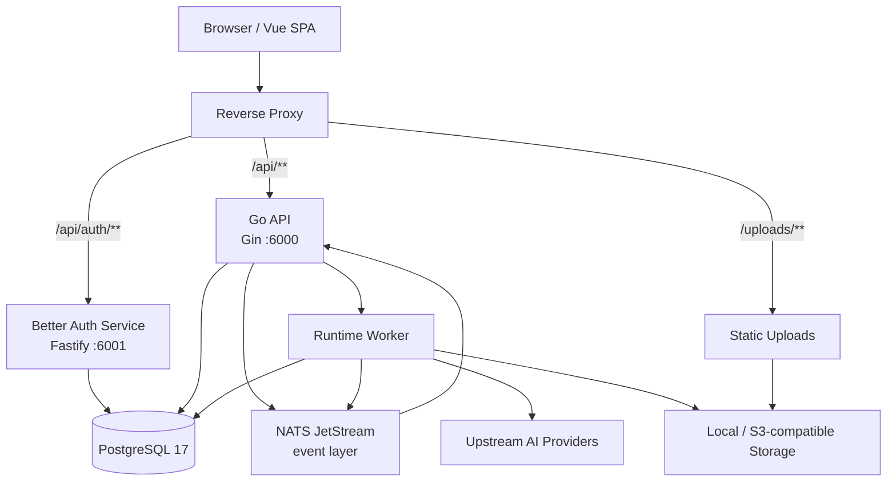

# IdeaBoard System Design

`DESIGN.md` 是 IdeaBoard 的系统设计契约。它记录当前架构为什么这样拆、跨模块协作如何发生，以及改动时必须守住的 invariants。

它不是快速启动手册、部署手册、API 字段清单或迁移历史。需要执行命令时看 [DEVELOPMENT.md](./DEVELOPMENT.md)；需要线上操作时看 [docs/runbooks/](./docs/runbooks/)。

## 文档职责

| 文档 | 主问题 |
| ---- | ------ |
| [README.md](./README.md) | 这个项目是什么，怎么快速跑起来？ |
| [DESIGN.md](./DESIGN.md) | 系统为什么这样设计，哪些 contract 不能破坏？ |
| [docs/adr/](./docs/adr/) | system-wide architecture decisions 的 ADR、status 和后续替代关系是什么？ |
| [DEVELOPMENT.md](./DEVELOPMENT.md) | 今天要改代码，应看哪些入口、跑哪些验证？ |
| [apps/web/DESIGN.md](./apps/web/DESIGN.md) | Agent 做前端 UI 改动时必须遵守哪些规则？ |
| [docs/runbooks/](./docs/runbooks/) | 部署、运营、安全、数据保护等动作怎么执行？ |
| `CONTEXT.md` | 某个 bounded context 的 domain language 和局部规则是什么？ |
| [AGENTS.md](./AGENTS.md) | Agent 和 coding rules 应如何约束执行？ |

新增文档前先问：它回答的主问题是否已经由上表覆盖。能合并就合并，避免创建第二事实源。

## 系统形态

IdeaBoard 是面向图像设计与电商展示场景的 AI 画布工作流平台。系统围绕 Canvas Board、workflow feature、Task、Prompt、AccountPool 和 Media Storage 协作。

生产推荐形态是 Cloudflare Pages 托管 Web，VPS 反代 API/Auth/Uploads，Docker Compose 运行 Go API、Auth、PostgreSQL、NATS JetStream 和 worker runtime。

## 核心设计契约

### 1. Canvas 是产品主界面

Canvas Workspace 负责把用户输入、节点编排、工具参数、任务执行和结果回写放进同一交互面。前端可以有多个页面和 Admin vertical contexts，但产品主链路必须继续以 Canvas Board 和 workflow feature 为中心。

Canvas 术语以 [apps/web/src/features/canvas/CONTEXT.md](./apps/web/src/features/canvas/CONTEXT.md) 为准。特别注意：

- `Canvas Board` 是持久化 graph document。
- `Vue Flow Pane` 是 graph interaction plane，不等同于产品意义上的 Canvas。
- `Canvas Node` 是 domain node，`Flow Node` 是 Vue Flow runtime representation。
- `Execution Plan` 是把节点转成一个或多个 Task 的准备结果，不等同于 Task。

### 2. Workflow feature 是执行语义边界

支持的 workflow feature slug 必须在前端 execution contract、OpenAPI、Go validation、prompt 配置和 Admin 展示中保持一致。

| Feature | 语义 |
| ------- | ---- |
| `sketch-to-image` | 草图成图 |
| `style-variation` | 风格延展 |
| `partial-edit` | 局部重绘 |
| `remove-bg` | 抠图 |
| `style-fusion` | 多图融合 |
| `pattern-gen` | 图案生成 |
| `hd-upscale` | HD |
| `outpaint` | 扩图 |

Contract rules:

- `feature` 是顶层任务字段，由后端统一校验。
- `image_urls` 是顶层媒体输入字段。
- `params` 只承载 feature-specific structured parameters。
- `use_mask`、`mask_image_url`、`mask_image_urls` 属于 `partial-edit` 的运行时边界参数，不是 prompt 模板变量。
- 产品文案、模板变量和展示分组只能描述当前可执行能力。

实现入口：

- [executionContract.ts](./apps/web/src/features/canvas/execution/contracts/executionContract.ts)
- [features.go](./apps/api/internal/workflow/features.go)

### 3. Tasking 的事实源是 PostgreSQL + River

任务提交必须保持 transactional：业务 task insert 和 River enqueue 必须在同一个 PostgreSQL transaction 中完成。不能出现“任务已落库但未入队”或“队列有 job 但业务 task 不存在”的 split-brain 状态。

River + PostgreSQL 负责：

- 任务入队、重试和 worker 执行
- 账号容量调度和无容量延迟重试
- 任务状态、取消标记和运行态事实源
- 队列监控的聚合来源

全部 canonical AI Image Workflow 都使用 Idea 计费；纯本地裁剪、调色、图层和蒙版绘制不进入 Task Billing。用户展示名使用 `Idea/Ideas`，内部 domain unit、代码、API 与 schema 继续使用 `Credit/credits`。Submit 必须在同一 PostgreSQL transaction 中完成 server-side Quote snapshot、Credit Hold、Task insert 与 River enqueue；成功终态与 Capture 原子提交，失败、取消或最终 timeout 与 Release 原子提交。Task status event 只能在该 transaction commit 后发布。

NATS JetStream 只负责持久领域事件、audit 和 realtime fanout。当前核心事件是 `task.status_changed`，由 API 实例 bridge 到本地 SSE hub。禁止把 NATS JetStream 恢复成任务执行队列，也不保留 Redis/Asynq/Dragonfly/Garnet 等生产兼容路径。

### 4. Worker 是 runtime adapter

`internal/runtime/worker` 消费 Tasking、AccountPool、Workflow、Prompts 和 Media 的接口，并拥有 provider calls、River worker execution、process-level retry 和运行时错误收敛。

不要把 worker implementation 挪进 Tasking。Tasking 拥有任务模型、提交、队列、统计和运行状态语义；worker 拥有执行适配。

### 5. Feature Prompt 只保存当前模板

`feature_prompts` 按 `feature_slug` 保存唯一当前 Prompt，原地更新，不创建 version、revision 或 history。模板变量和 merge policy 由代码维护，不属于运营配置。Billing 价格是 Workflow 是否可提交的唯一业务开关；Readiness 与 Submit 共用同一套 Prompt、typed params 和 Billing request 规划。任务提交不固化 model 或候选账号，worker 在每次执行时从当前已启用的 Provider Account 与 Model 池中按容量动态分配，并将实际 `resolved_model` 写入 lease。媒体输入、mask、多参考图、multipart 上传、本地重绘窗口和 provider 参数仍由运行时处理。

稳定变量和运营模板见 [docs/runbooks/system-prompts.md](./docs/runbooks/system-prompts.md)。

### 6. Auth 分成身份服务和业务授权

Better Auth Service 负责登录、注册、session、身份侧字段和凭据；Go API 负责业务用户档案、角色/status 判定、Admin 操作编排和业务权限。

业务 User identity 必须区分不同职责：`users.id` 仅用于数据库内部 PK/FK 与 Join，`users.public_id` 是不可变的公开 identity，`users.auth_user_id` 仅用于映射 Better Auth identity，`display_name` 是可修改且不唯一的展示资料，`storage_uid` 只用于 Media Storage namespace。Public API 的新引用必须使用 `public_id`，不得新增对内部 `id` 或 `auth_user_id` 的外部依赖。

高风险身份动作必须经由 Go Admin API 编排：

- 角色升降级需要同时同步 Auth Service 与业务侧 `users.role`。
- 彻底注销必须先在 Go API 的 PostgreSQL transaction 中停用业务用户、冻结 Credit Wallet lifecycle status 并记录 durable deletion phase，再按 Auth identity → Media Storage → business tombstone 顺序幂等收敛；跨服务失败期间 Wallet 不得恢复 active，Identity lifecycle 不得清除 Credits 拥有的原因化 Restriction。
- 前端不得直接调用 Better Auth admin client 执行跨库高风险动作。

运行规则见 [docs/runbooks/auth-operations.md](./docs/runbooks/auth-operations.md)。

### 7. Media 拥有上传、存储和引用边界

Media context 拥有 object storage provider/profile、upload serving、upload authorization、media references、image format validation 和 bundled business assets。Local 与 S3-compatible storage 是同一抽象下的 provider choice。

上传结果、provider output 和用户素材都必须通过 Media/Storage 边界进入业务语义。不要让无关 feature 直接拼接 storage secret、bucket URL 或本地文件路径。

### 8. Admin 是 vertical contexts

Admin route pages 不直接依赖 generated API。每个 Admin vertical context 自己拥有 resource access、view model、command sequencing、cache invalidation 和 side effect handling。

| Frontend context | Backend context | Ownership |
| ---------------- | --------------- | --------- |
| `features/admin/users` | `internal/identity/users` | 用户列表、角色/status、会话、伪装登录、受控注销 |
| `features/admin/provider-config` | `internal/accountpool` | channel/account/provider payload、模型检测、调度可见性 |
| `features/admin/prompt-config` | `internal/prompts`, `internal/workflow` | 当前 Workflow Feature 的 prompt template；变量和 merge policy 由代码维护 |
| `features/admin/storage` | `internal/media/storage` | storage provider/profile、secret masking、bucket test/apply |
| `features/admin/task-monitor` | `internal/tasking` | task list/detail、runtime monitor、stream/poll fallback |
| `features/admin/statistics` | `internal/tasking/taskstats` | statistics aggregation、backfill status、range contract |
| `features/admin/credits-billing` | `internal/billing`, `internal/credits`, `internal/rewards`, `internal/payments` | Registry-backed 功能定价 Catalog、Wallet/Ledger operations、Credit Health、RewardCode 运营与 Stripe 配置 |

### 9. Generated code 是边界，不是业务模型

`apps/web/src/shared/api/generated-query` 是 Orval generated code，不手动编辑。Vue route pages 和 components 不直接依赖 generated API；依赖必须收口到 feature context、shared composable 或明确的 API adapter。

Backend generated sqlc code 不手动编辑。修改 SQL queries/schema 后运行 `go tool sqlc generate`，让 generated code 跟随事实源更新。

API schema source 以 domain fragments 和显式 manifest 组织，`schema.sql` 是 generated snapshot，不能手工编辑。唯一 schema lifecycle 是 `cd apps/api && go run ./cmd/schema-release`：开发者在修改 fragment 或 manifest 后使用 `--write-artifact` 生成 snapshot，默认模式执行完整 release contract check；CI 与 deployment release gate 只调用默认模式。API migration history 由 Atlas versioned migrations 管理，`atlas.sum` 固定 migration integrity，独立 `api-migrate` image 先执行 Atlas apply，再由 `finalize-migrate` 完成 River migration 与 runtime privilege setup。Pre-launch clean break 只允许原子删除旧 SQL chain 并新增一个更高版本 baseline，且必须重建 Fresh Database；不通过 legacy replay 或手工修改 Atlas revisions 兼容。

### 10. Statistics 必须幂等

统计模型以任务为去重边界：

- `TaskStatEvent` 按 `task_id` 去重，保证同一任务只计数一次。
- `TaskDailyStat` 按 `(stat_date, model_name, user_key)` upsert 聚合。
- `TaskDailyStatBackfill` 标记某日期历史扫描已完成，避免重复回填。
- 前端统计 API 返回 `backfill_status`，由前端决定是否触发补录。

## Backend Context Map

Backend context map 的局部规则见 [apps/api/CONTEXT.md](./apps/api/CONTEXT.md)。

| Context | Directories | Responsibility |
| ------- | ----------- | -------------- |
| Runtime | `internal/runtime`, `cmd` | 进程启动、HTTP route wiring、worker adapters、embedded frontend dist |
| Platform | `internal/platform`, `internal/db`, `internal/events` | config、database、response helpers、safe HTTP、event bus、sqlc |
| Tasking | `internal/tasking` | task model、submission、queueing、runtime state、statistics |
| Identity | `internal/identity` | auth middleware/client、user persistence、user/admin management |
| AccountPool | `internal/accountpool` | accounts、channels、load、scheduling visibility |
| Boards | `internal/boards` | board ownership、access checks、board management API |
| Media | `internal/media` | storage、assets、media refs、image format validation |
| Workflow/Prompts | `internal/workflow`, `internal/prompts` | executable feature contract、task params、prompt templates、prompt assembly |
| Billing | `internal/billing` | 全局 immutable SKU identity、versioned Credit pricing、server-side Quote snapshot |
| Billing Records | `internal/billingrecords` | 用户侧最终 Idea 收支 Read Model；组合 Credits Ledger 与 immutable Task Billing snapshot，不拥有账务写入 |
| Credits | `internal/credits` | 平台 Credit Wallet（用户展示为 Idea）、Double-entry Ledger、余额 projection、幂等 Credit Commands |
| Rewards | `internal/rewards` | RewardCode、Redemption、用户 history 与 Credits Grant 编排 |
| [Payments](./apps/api/internal/payments/CONTEXT.md) | `internal/payments` | Stripe 配置、签名 Webhook Inbox 与支付生命周期；Idea 余额和 Ledger 写入仍由 Credits 独占 |
| Usage | `internal/usage` | 用户侧用量 Read Model；组合 Credits Capture 与 durable Task Billing snapshot，返回 Lifetime 摘要与每日 Capture Trend，不拥有账务或任务写入 |

Dependency direction:

- `cmd` stays lightweight and calls `internal/runtime/bootstrap`.
- `internal/runtime` composes platform modules and business contexts.
- Business contexts may depend on `internal/platform` and `internal/db/sqlc` through local repositories/adapters.
- `internal/platform` must not import business contexts.
- Cross-context collaboration should use small service/repository interfaces at the caller boundary.
- Products consume Credits through the `credits.Commands` seam; only Credits owns Ledger writes and balance projections.
- Rewards owns RewardCode/Redemption but must grant Ideas through transaction-bound `credits.Commands`; Code plaintext is never persisted.
- Products ask Billing for an immutable `PriceSnapshot`; Provider Account routing must not influence SKU price. Billing does not write the Credits Ledger.
- Tasking 通过 `internal/tasking/taskbilling` 编排 Billing Quote 与 Credits Commands，并持久化不可变 Task Billing snapshot；Billing/Credits 仍分别拥有价格事实和 Ledger 写入。

## Frontend Context Map

Frontend context rules:

- `apps/web/src/app` owns startup, router and store wiring.
- `features/public-site` owns anonymous English Public Site routes, Public Fact Registry, Editorial Content and build-time static HTML output; it does not own authenticated Workspace rendering.
- `apps/web/src/features` owns business modules, route pages, feature-local UI and adapters.
- `apps/web/src/shared` only contains cross-feature API helpers, auth, types, utils and assets.
- `shared` must not depend on concrete feature modules.
- Canvas submodules should depend through their `index.ts` public seams when crossing submodule boundaries.
- `features/canvas-board/domain` remains the shared snapshot schema/core module.
- Frontend UI changes must follow the agent protocol in [apps/web/DESIGN.md](./apps/web/DESIGN.md).

## Operational Invariants

- Production must set high-entropy `BETTER_AUTH_SECRET`, matching `AUTH_INTERNAL_KEY` on API/Auth, and `APP_SECRETS_ENCRYPTION_KEY`.
- PostgreSQL migration owner credentials must only enter migration processes; API/Auth runtimes use distinct limited roles and fail startup if their effective privileges can bypass the Credits boundary.
- API/Auth should listen on loopback behind reverse proxy in production.
- River worker concurrency 是部署级 `RIVER_WORKER_CONCURRENCY`；retry/timeout policy 由 Worker 代码拥有，NATS retention 由 Events implementation 固定为 7 天。Admin 只管理 typed Outbound Policy；allowlist 在 request-time 动态读取并 fail closed，写入必须与 append-only actor audit 原子提交。
- Cloudflare proxied API domains need explicit cache bypass for API/Auth/SSE/upload writes and careful real-client-IP handling.
- Rewards Redeem 在应用内按 User 执行 10 attempts / 10 minutes 的 instance-local limit；生产 Cloudflare/reverse proxy 必须另对 `/api/user/rewards/redeem` 按可信客户端 IP 执行初始 60 attempts / 10 minutes 的 coarse limit。
- Rewards rollout 只支持 canonical RewardCode schema 的 Fresh Database path。检测到已删除的 Rewards migration version 或 immutable Ledger reference 时 migration 必须 fail closed，禁止兼容性 replay、静默删除或语义 orphan。
- PostgreSQL backup contains credentials and user/session data; treat `postgres-*.dump[.age|.gpg]` as secret artifacts.
- DB restore and migration rollback are human-confirmed operations; runtime image rollback does not imply automatic database restore.

Operational procedures live in:

- [docs/runbooks/deployment.md](./docs/runbooks/deployment.md)
- [docs/runbooks/auth-operations.md](./docs/runbooks/auth-operations.md)
- [docs/runbooks/data-protection.md](./docs/runbooks/data-protection.md)
- [docs/runbooks/system-prompts.md](./docs/runbooks/system-prompts.md)

## Change Rules

Use this checklist before architectural changes:

1. Does the change preserve the Tasking transactional boundary?
2. Does it keep River as task queue and NATS as event layer?
3. Does it avoid generated API/sqlc as hand-written business code?
4. Does it keep route pages away from generated API details?
5. Does it preserve workflow feature slug and params contract across FE/OpenAPI/Go/Admin?
6. Does it keep Auth high-risk operations behind Go Admin API?
7. Does it update the relevant `CONTEXT.md` if domain language changed?
8. Does it update `DEVELOPMENT.md` only if the developer workflow changed?

If a change intentionally breaks one of these contracts, capture the new decision in this file or a system-wide ADR under [docs/adr/](./docs/adr/) before landing the implementation.
