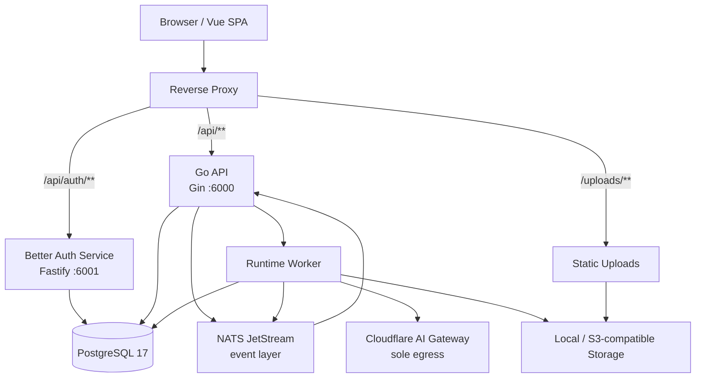

# IdeaBoard System Design

`DESIGN.md` 是 IdeaBoard 的系统设计契约。它记录当前架构为什么这样拆、跨模块协作如何发生，以及改动时必须守住的 invariants。

它不是快速启动手册、部署手册、API 字段清单或迁移历史。需要执行命令时看 [DEVELOPMENT.md](./DEVELOPMENT.md)；需要线上操作时看 [docs/runbooks/](./docs/runbooks/)。

## 文档职责

| 文档                                       | 主问题                                                                   |
| ------------------------------------------ | ------------------------------------------------------------------------ |
| [README.md](./README.md)                   | 这个项目是什么，怎么快速跑起来？                                         |
| [DESIGN.md](./DESIGN.md)                   | 系统为什么这样设计，哪些 contract 不能破坏？                             |
| [docs/adr/](./docs/adr/)                   | system-wide architecture decisions 的 ADR、status 和后续替代关系是什么？ |
| [DEVELOPMENT.md](./DEVELOPMENT.md)         | 今天要改代码，应看哪些入口、跑哪些验证？                                 |
| [apps/web/DESIGN.md](./apps/web/DESIGN.md) | Agent 做前端 UI 改动时必须遵守哪些规则？                                 |
| [docs/runbooks/](./docs/runbooks/)         | 部署、运营、安全、数据保护等动作怎么执行？                               |
| `CONTEXT.md`                               | 某个 bounded context 的 domain language 和局部规则是什么？               |
| [AGENTS.md](./AGENTS.md)                   | Agent 和 coding rules 应如何约束执行？                                   |

新增文档前先问：它回答的主问题是否已经由上表覆盖。能合并就合并，避免创建第二事实源。

## 系统形态

IdeaBoard 是面向图像设计与电商展示场景的 AI 画布工作流平台。系统围绕 Canvas Board、workflow feature、Task、Prompt、AI Gateway 出口和 Media Storage 协作。AccountPool 已退役，见 [ADR-0009](./docs/adr/0009-accountpool-retirement.md)。



生产推荐形态是 Cloudflare Pages 托管 Web，VPS 反代 API/Auth/Uploads，Docker Compose 运行 Go API、Auth、PostgreSQL、NATS JetStream 和 worker runtime。

## 核心设计契约

### 1. Canvas 是产品主界面

Canvas Workspace 负责把用户输入、节点编排、工具参数、任务执行和结果回写放进同一交互面。前端可以有多个页面和 Admin vertical contexts，但产品主链路必须继续以 Canvas Board 和 workflow feature 为中心。

Canvas 术语以 [apps/web/src/features/canvas/CONTEXT.md](./apps/web/src/features/canvas/CONTEXT.md) 为准。特别注意：

- `Canvas Board` 是持久化 graph document。
- `Vue Flow Pane` 是 graph interaction plane，不等同于产品意义上的 Canvas。
- `Canvas Node` 是 domain node，`Flow Node` 是 Vue Flow runtime representation。
- `Execution Plan` 是把节点转成一个或多个 Task 的准备结果，不等同于 Task。

### 2. Workflow feature 是执行语义边界

支持的 workflow feature slug 必须在前端 execution contract、OpenAPI、Go validation、prompt 配置和 Admin 展示中保持一致。

| Feature      | 语义     |
| ------------ | -------- |
| `generation` | Prompt 生图（纯文本指令 + 最多 4 张参考图） |
| `render`     | 草图成图 |
| `variations` | 风格延展 |
| `inpaint`    | 局部重绘 |
| `cutout`     | 抠图     |
| `fusion`     | 多图融合 |
| `upscale`    | 放大     |
| `outpaint`   | 扩图     |

Contract rules:

- 顶层判别字段是 `service`（不是 `feature`），由后端 `workflow.ValidateWorkflowFeatureSlug` 统一校验；`params.service` 是同义来源。
- 媒体输入走 `inputs.media_asset_ids`（有序 `AssetID + role` 引用）与 `inputs.prompt`；持久化 Task Params 不保存任何 storage URL。
- `params` 只承载 service-specific structured parameters，未知 key 直接 422。
- `vision` 是永久保留 slug（Vision Search 专用映射），永远不能注册为 workflow feature。
- `use_mask`、`mask_image_url`、`mask_image_urls` 属于 `inpaint` 的运行时边界参数，不是 prompt 模板变量。
- 产品文案、模板变量和展示分组只能描述当前可执行能力。

实现入口：

- [executionContract.ts](./apps/web/src/features/canvas/domain/execution-contracts/executionContract.ts)
- [features.go](./apps/api/internal/workflow/features.go)

### 3. Tasking 的事实源是 PostgreSQL + River

任务提交必须保持 transactional：业务 task insert 和 River enqueue 必须在同一个 PostgreSQL transaction 中完成。不能出现“任务已落库但未入队”或“队列有 job 但业务 task 不存在”的 split-brain 状态。

River + PostgreSQL 负责：

- 任务入队、重试和 worker 执行
- 任务状态、取消标记和运行态事实源
- 队列监控的聚合来源

全部 canonical AI Image Workflow 都使用 Idea 计费；纯本地裁剪、调色、图层和蒙版绘制不进入 Task Billing。用户展示名使用 `Idea/Ideas`，内部 domain unit、代码、API 与 schema 继续使用 `Credit/credits`。Submit 必须在同一 PostgreSQL transaction 中完成 server-side Quote snapshot、`RoutingSnapshot` 固化、Credit Hold、Task insert 与 River enqueue；成功终态与 Capture 原子提交，失败、取消或最终 timeout 与 Release 原子提交。Task status event 只能在该 transaction commit 后发布。

NATS JetStream 只负责持久领域事件、audit 和 realtime fanout。当前核心事件是 `task.status_changed`，由 API 实例 bridge 到本地 SSE hub。禁止把 NATS JetStream 恢复成任务执行队列，也不保留 Redis/Asynq/Dragonfly/Garnet 等生产兼容路径。

### 4. Worker 是 runtime adapter

workspace task 的执行适配器是 `internal/tasking/interfaces/worker`：它消费 Tasking、Workflow、Prompts 和 Media 的接口，经 `internal/runtime/interfaces/worker/providers` 做 Cloudflare AI Gateway provider calls，并收敛运行时错误。River worker execution 与周期性后台 job（credit reconciliation、payment、retention、vision billing）由 `internal/runtime/interfaces/worker` 的 `river`/`billing`/`retention`/`visionbilling` 子包拥有。

重试分三层，各自有独立事实（`ExecutionAttempt.retry_layer` 与 `gateway_retry_count`）：网关内部重试（同 Model，有界 HTTP policy，归 gateway adapter）、Model fallback（最多一次，只用快照里的 `retry_candidate`，归 worker）、River 整任务重投（transient 失败后按 `MaxProviderRequeues` 整任务 requeue，reset + River backoff + 新 execution token，以 `tasks.retry_count` 为界，归 task lifecycle）。确定性失败（参数非法、额度不足、内容安全拒绝、鉴权失败、not-found、成功但 payload 不可用）直接终态，绝不消耗 fallback 预算；无标记的未知结果同样 fail closed 到终态，见 [ADR-0008](./docs/adr/0008-cloudflare-ai-gateway-sole-egress.md)、[ADR-0010](./docs/adr/0010-gateway-cache-billing-timeout.md) 与 [ADR-0012](./docs/adr/0012-service-model-pool-routing-contract.md)。

不要把 provider execution 和后台 job adapter 挪进 Tasking。Tasking 拥有任务模型、提交、队列、统计和运行状态语义，其 `interfaces/worker` 拥有 workspace task 的执行编排（快照消费、attempt 事实、重试分层）；provider 方言与网关调用、River worker execution 和后台 job 仍属 Runtime。

模型图片请求的 vendor 方言收敛在 `internal/runtime/interfaces/worker/providers/dialects`：按 `(provider, model, customParams)` 一次分发（chat 判定优先、Fal 专表、其余 generic），shaping 与解析纯函数无网络。路径推断仍归 `workflow.ResolveRoute`（execution 与 preview 共用单 seam），membership 与别名归 `workflow.ResolveProvider`，custom 参数由 worker 在 Encode 后合并一次，重试/缓存/超时归网关（ADR-0008/0010）。claim 与 attempt 行在同一 SQL 语句原子提交，不存在有 token 无 attempt 行的中间态。

### 5. Feature Prompt 只保存当前模板

`feature_prompts` 按 `feature_slug` 保存唯一当前 Prompt，原地更新，不创建 version、revision 或 history。模板变量和 merge policy 由代码维护，不属于运营配置。Billing 价格与 Service Model Pool 路由都必须在 Hold 前通过校验；Readiness 与 Submit 共用 Prompt、typed params 和 Billing request 规划。#847 完成字段改名后，Readiness、Quote 与 Submit 共用同一个 `RoutingResolver` 判定，缺失或空的 Service Model Pool 路由在任何 Hold 之前就以 `service_resolution_unavailable` fail closed。#848 已落地：Submit 在同一 settlement transaction（Credit Hold + task insert + River enqueue）里固化不可变 `RoutingSnapshot`，worker 只消费该快照，绝不读取实时 Model 映射，也不从 live pool 回落；快照缺失或无法 replay 时同样 fail closed（释放 Hold、不烧重试预算）。价格不受模型影响，见 [ADR-0012](./docs/adr/0012-service-model-pool-routing-contract.md)。媒体输入、mask、多参考图、multipart 上传、本地重绘窗口和 provider 参数仍由运行时处理。

稳定变量和运营模板见 [docs/runbooks/system-prompts.md](./docs/runbooks/system-prompts.md)。

### 6. Auth 分成身份服务和业务授权

Better Auth Service 负责登录、注册、session、身份侧字段和凭据；Go API 负责业务用户档案、角色/status 判定、Admin 操作编排和业务权限。

业务 User identity 必须区分不同职责：`users.id` 仅用于数据库内部 PK/FK 与 Join，`users.public_id` 是不可变的公开 identity，`users.auth_user_id` 仅用于映射 Better Auth identity，`display_name` 是可修改且不唯一的展示资料，`storage_uid` 只用于 Media Storage namespace。Public API 的新引用必须使用 `public_id`，不得新增对内部 `id` 或 `auth_user_id` 的外部依赖。

高风险身份动作必须经由 Go Admin API 编排：

- 角色升降级需要同时同步 Auth Service 与业务侧 `users.role`。
- 彻底注销必须先在 Go API 的 PostgreSQL transaction 中停用业务用户、冻结 Credit Wallet lifecycle status 并记录 durable deletion phase，再按 Auth identity → Media Storage → business tombstone 顺序幂等收敛；跨服务失败期间 Wallet 不得恢复 active，Identity lifecycle 不得清除 Credits 拥有的原因化 Restriction。
- 前端不得直接调用 Better Auth admin client 执行跨库高风险动作。该边界由机制强制，而非仅靠约定：Auth Service 用 better-auth `roles` 把 admin 角色收窄到 `user:["impersonate"]`（`stop-impersonating` 端点本身不需要权限），反代对 `/api/auth/admin/` 下除该端点外的路径返回 403，且前端 bundle 不注册 `adminClient()`。Go Control Plane 通过 internal-key 认证的 `/internal/users/*` 执行其余高危动作，走内网直连 Auth Service。

运行规则见 [docs/runbooks/auth-operations.md](./docs/runbooks/auth-operations.md)。

### 7. Media 拥有上传、存储和引用边界

Media context 拥有 object storage provider/profile、upload serving、upload authorization、media references、image format validation 和 bundled business assets。Local 与 S3-compatible storage 是同一抽象下的 provider choice。

上传结果、provider output 和用户素材都必须通过 Media/Storage 边界进入业务语义。不要让无关 feature 直接拼接 storage secret、bucket URL 或本地文件路径。

### 8. Admin 是 vertical contexts

Admin route pages 不直接依赖 generated API。每个 Admin vertical context 自己拥有 resource access、view model、command sequencing、cache invalidation 和 side effect handling。垂直划分以 [navigationMeta.ts](./apps/web/src/features/admin/app/navigationMeta.ts) 的 navigation key 为准；`storage` 与 `payments` 作为独立 context 存在，分别内嵌在 `settings` 与 `credits` 布局下。

| Frontend context            | Backend context                                                          | Ownership                                                                                             |
| --------------------------- | ------------------------------------------------------------------------ | ---------------------------------------------------------------------------------------------------- |
| `features/admin/users`      | `internal/identity/users`                                                | 用户列表、角色/status、会话、伪装登录、受控注销                                                        |
| `features/admin/models`     | `internal/aigateway`                                                     | 网关连接、模型目录、映射规则、route preview 与连通性探测（Service Model Pool 归 Generation）          |
| `features/admin/prompts`    | `internal/prompts`, `internal/workflow`                                  | 当前 workflow feature 的 prompt template；变量和 merge policy 由代码维护                              |
| `features/admin/storage`    | `internal/media/storage`                                                 | storage provider/profile、secret masking、bucket test/apply                                           |
| `features/admin/monitor`    | `internal/tasking`                                                       | task list/detail/cancel、runtime monitor、stream/poll fallback                                          |
| `features/admin/statistics` | `internal/tasking/application/statistics`                                 | statistics aggregation、backfill status、range contract                                                 |
| `features/admin/credits`    | `internal/billing`, `internal/credits`, `internal/rewards`, `internal/generation` | Registry-backed 功能定价 Catalog、Service Model Pool 版本与 Admin 写入、Wallet/Ledger operations、Credit Health、RewardCode 运营 |
| `features/admin/payments`   | `internal/payments`                                                      | 支付订单查询/退款/争议、Stripe 配置                                                                    |
| `features/admin/settings`   | `internal/platform/settings`, `internal/searchcatalog`                   | 网站 branding/access/mediaUpload、限流、typed Outbound Policy、搜索 provider key；邮件配置经 Go Control Plane 转发到 Auth Service |

### 9. Generated code 是边界，不是业务模型

`apps/web/src/shared/api/generated-query` 是 Orval generated code，不手动编辑。Vue route pages 和 components 不直接依赖 generated API；依赖必须收口到 feature context、shared composable 或明确的 API adapter。

Backend generated sqlc code 不手动编辑。修改 SQL queries/schema 后运行 `go tool sqlc generate`，让 generated code 跟随事实源更新。

API schema source 以 domain fragments 和显式 manifest 组织，`schema.sql` 是 generated snapshot，不能手工编辑。唯一 schema lifecycle 是 `cd apps/api && go run ./cmd/schemarelease`：开发者在修改 fragment 或 manifest 后使用 `--write-artifact` 生成 snapshot，默认模式执行完整 release contract check；CI 与 deployment release gate 只调用默认模式。API migration history 由 Atlas versioned migrations 管理，`atlas.sum` 固定 migration integrity，独立 `api-migrate` image 先执行 Atlas apply，再由 `finalize-migrate` 完成 River migration 与 runtime privilege setup。Pre-launch clean break 只允许原子删除旧 SQL chain 并新增一个更高版本 baseline，且必须重建 Fresh Database；不通过 legacy replay 或手工修改 Atlas revisions 兼容。

### 10. Statistics 必须幂等

统计模型以任务为去重边界：

- `TaskStatEvent` 按 `task_id` 去重，保证同一任务只计数一次。
- `TaskDailyStat` 按 `(stat_date, model_name, user_key)` upsert 聚合。
- `TaskDailyStatBackfill` 标记某日期历史扫描已完成，避免重复回填。
- 前端统计 API 返回 `backfill_status`，由前端决定是否触发补录。

## Backend Context Map

Backend context map 的局部规则见 [apps/api/CONTEXT.md](./apps/api/CONTEXT.md)。

| Context                                             | Directories                                           | Responsibility                                                                                                                             |
| --------------------------------------------------- | ----------------------------------------------------- | ------------------------------------------------------------------------------------------------------------------------------------------ |
| Runtime                                             | `internal/runtime`, `cmd`                             | 进程启动生命周期、`internal/runtime/composition` 唯一装配根、HTTP/Worker interface adapters、后台 job adapters、embedded frontend dist             |
| Platform                                            | `internal/platform`, `internal/db`, `internal/events` | config、system settings、database、response helpers、safe HTTP、event bus、sqlc                                                             |
| Tasking                                             | `internal/tasking`                                    | task model、submission、queueing、runtime state、task billing、statistics                                                                  |
| Identity                                            | `internal/identity`                                   | auth middleware/client、user persistence、user/admin management                                                                            |
| Tenancy                                             | `internal/tenancy`                                    | Workspace、Organization、membership 生命周期与 role 约束、workspace billing account 绑定；不拥有账务写入                                      |
| AccountPool（已退役，见 ADR-0009）                   | —                                                     | Account/endpoint rows remain for historical references; credential material is purged. AI egress belongs to Cloudflare AI Gateway          |
| [AI Gateway](./apps/api/internal/aigateway/CONTEXT.md) | `internal/aigateway`                                | 唯一 AI 出口的配置面：gateway connection、model catalog、Vision mapping、route preview 与探测；不拥有 Wallet、Ledger、价格或 Service Model Pool   |
| Boards                                              | `internal/boards`                                     | board ownership、access checks、board management API                                                                                       |
| Media                                               | `internal/media`                                      | storage、assets、derivatives、media refs、image format validation                                                                         |
| Library                                             | `internal/library`                                    | 外部灵感素材收藏、Folder、幂等保存与 cursor 分页；只保存 provider URL 和 source metadata                                                   |
| [SearchCatalog](./apps/api/internal/searchcatalog/CONTEXT.md) | `internal/searchcatalog`                  | 图片搜索：Unsplash/Pexels provider key 生命周期与 Vision Search（独立计费）；Vision 模型只来自 AI Gateway vision mapping                   |
| Workflow/Prompts                                    | `internal/workflow`, `internal/prompts`               | executable feature contract、task params、prompt templates、prompt assembly；只做 feature 编译与参数 shaping，从不选 Model                          |
| Generation                                          | `internal/generation`                                 | Service Model Pool 的 `routing`（纯领域：eligibility、确定性选型、retry candidate、`RoutingSnapshot`）与 `catalog`（pool 持久化、快照 save/load）    |
| Billing                                             | `internal/billing`                                    | 全局 immutable SKU identity、versioned Credit pricing、server-side Quote snapshot                                                          |
| Billing Records                                     | `internal/billingrecords`                             | 用户侧最终 Idea 收支 Read Model；组合 Credits Ledger 与 immutable Task Billing snapshot，不拥有账务写入                                    |
| Credits                                             | `internal/credits`                                    | 平台 Credit Wallet（用户展示为 Idea）、Double-entry Ledger、余额 projection、幂等 Credit Commands                                          |
| Rewards                                             | `internal/rewards`                                    | RewardCode、Redemption、用户 history 与 Credits Grant 编排                                                                                 |
| [Payments](./apps/api/internal/payments/CONTEXT.md) | `internal/payments`                                   | Stripe 配置、签名 Webhook Inbox 与支付生命周期；Idea 余额和 Ledger 写入仍由 Credits 独占                                                   |
| Usage                                               | `internal/usage`                                      | 用户侧用量 Read Model；组合 Credits Capture 与 durable Task Billing snapshot，返回 Lifetime 摘要与每日 Capture Trend，不拥有账务或任务写入 |

Dependency direction:

- `cmd` stays lightweight and delegates process wiring to `internal/runtime/composition`.
- `internal/runtime` composes platform modules and business contexts; `composition` is the sole assembly root.
- Business contexts may depend on `internal/platform` and `internal/db/sqlc` through local repositories/adapters.
- `internal/platform` must not import business contexts.
- Business contexts must never depend on `internal/runtime`; runtime interfaces and adapters stay isolated.
- Cross-context collaboration should use small service/repository interfaces at the caller boundary.
- Products consume Credits through the `credits.Commands` seam; only Credits owns Ledger writes and balance projections.
- Rewards owns RewardCode/Redemption but must grant Ideas through transaction-bound `credits.Commands`; Code plaintext is never persisted.
- Products ask Billing for an immutable `PriceSnapshot`; Service Model Pool routing must not influence SKU price. Billing does not write the Credits Ledger.
- Tasking 通过 `internal/tasking/application/billing` 编排 Billing Quote 与 Credits Commands，并持久化不可变 Task Billing snapshot；Billing/Credits 仍分别拥有价格事实和 Ledger 写入。
- Service Model Pool 的选型只由 `internal/generation` 拥有：Tasking 的 Quote/Submit 调用它拿 `RoutingSnapshot` 并在 settlement transaction 中固化，worker 只读快照；Business contexts 不得自行查 live pool。

## Frontend Context Map & Architecture Contract

### 1. Feature Ownership Map

前端业务逻辑收敛于 `apps/web/src/features`。目录命名反映真实业务所有权，不为了死板套用模板而臆造 `entities` 或 `widgets`。

| Context / Feature   | Directory                     | Business Ownership                                                                                                | Key Models & State Machines                                               |
| ------------------- | ----------------------------- | ----------------------------------------------------------------------------------------------------------------- | ------------------------------------------------------------------------- |
| Canvas Workspace    | `features/canvas`             | AI 画布交互面、节点运行时、工具链（Retouch/Inpaint/Brush/Select）、命令编排与任务生命周期                         | Canvas Node/Edge runtime, Tool State Machine, Execution Plan, Task Runner |
| Board               | `features/board`              | 看板全生命周期事实源：持久化文档模型、快照 Schema、媒体引用提取、看板 CRUD 与画廊列表、协作加入、revision/乐观锁同步、持久化与预览适配器 | `BoardState`, Valibot `stateSchema`, `boardRepository`, `boardSync`, `previewSerializer` |
| Account             | `features/account`            | 用户额度（Idea/Credits）查看与刷新、Stripe 充值收银台、兑换码兑换、账单记录与用量统计明细                         | Wallet balance, Recharge session state machine, Redemption, Usage trend   |
| Admin Verticals     | `features/admin`              | 管理端独立垂直子域（用户管理、积分运营、数据仪表盘、任务监控、模型管理、系统提示词、系统设置）             | Vertical context view models, Admin resources, Policy inspection          |
| Auth & Identity     | `features/auth`               | 认证与会话状态（Better Auth 集成、登录/注册弹窗与路由拦截、凭据校验、Auth Bridge）                                | Session state, Auth token lifecycle, Login/Register workflows             |
| Library             | `features/library`            | 外部灵感素材收藏、分类文件夹、媒体引用与拖拽入画布交互                                                            | Library item model, Folder taxonomy, cursor pagination                    |
| Workspace           | `features/workspace`          | 工作区外壳与路由承载：应用全局外壳布局、顶栏导航、工作区路由与协作加入（保留外部 /user/* URL 契约）              | Shell layout state, navigation triggers, workspace routes, share-join      |
| Search              | `features/search`             | 灵感素材搜索、Vision Search、素材引用与搜索结果持久化                                                             | Search query state, vision reference state                                |
| Legal               | `features/legal`              | 服务条款、隐私政策协议与合规展示                                                                                  | Terms, Privacy Policy documents                                           |

匿名公开落地页不是独立 context：`/` 路由直接渲染 `features/canvas/presentation/pages/CanvasLandingPage.vue`，公开访问与 SEO 由 router meta 表达（见 [router/index.ts](./apps/web/src/app/router/index.ts)）。新增公开页面属于 Canvas presentation 层，不要为此新建 `public-site` 之类的平行 vertical。

### 2. Complex Feature Layering Contract (Architecture Contract)

复杂业务特性在进行 DDD 物理重构或代码演进时，可采用如下分层契约。简单展示型特性保持轻量结构，不得为了满足模板创建空目录或空抽象：

- **`domain/`（纯领域层）**：
  - 拥有纯业务模型、实体与值对象、状态机转换纯函数、领域校验规则。
  - **Hard Constraint**：严禁导入 Vue 响应式 API（如 `ref`, `reactive`）、Vue Router、Pinia、TanStack Query 或网络传输层（Generated API DTOs）。
  - 核心领域规则和状态转换必须具备 focused、deterministic 的单元测试；这不等同于要求 100% 全量 coverage。
- **`application/`（用例编排层）**：
  - 拥有具体业务用例（Use Cases）与工作流编排 Composables（如 `useUserRecharge`, `useTaskExecution`）。
  - 负责协调领域逻辑、资源适配器与交互状态；管理生命周期、轮询与缓存失效机制。
- **`infrastructure/`（基础设施与适配层）**：
  - 拥有网络传输、本地存储（IndexedDB/LocalStorage）、外部 SDK 与 API 资源适配器（Resource / Adapter）。
  - 负责将传输层 DTO 翻译为特性领域模型（DTO <-> Domain Model mapping），集中处理 HTTP 错误归一化。
- **`ui/`（视图呈现层）**：
  - 拥有 Vue SFC 组件、页面和弹窗。
  - 仅负责状态渲染、交互事件分发与动画，不直接包含复杂业务逻辑或网络请求。
- **`ports/`（外部契约层，可选）**：
  - 定义跨特性或外部依赖的反向接口契约，用于解耦强依赖或用于测试 Mock。

### 3. 状态归属契约 (State Ownership Contract)

```text
TanStack Query   -> 服务端状态与远端缓存 (Server state and cache)
URL (Vue Router) -> 页面间可分享与回溯的导航、筛选与激活状态 (Nav & filter state)
Form state       -> 本地表单输入与即时校验 (Local form state)
Local composable -> 组件或弹窗内的临时交互状态 (Transient interaction state)
Global store     -> 明确跨页面共享的纯客户端状态 (Shared client-only state)
```

禁止将 API 返回数据随意拷贝到多个全局 Store 中。每个特性必须明确其唯一事实源（Source of Truth）与缓存失效策略（Invalidation Strategy）。

### 4. API 边界契约 (API Boundary Contract)

严格执行如下单向调用链：

```text
Vue UI -> application use case -> resource/adapter -> generated API
```

- Vue 组件、路由页面与 app composition 层严禁直接调用 `apps/web/src/shared/api/generated-query` 生成代码。
- Generated API 仅允许在各 feature 的 resource/adapter 或 shared API adapter 中被封装调用。
- 绝不手工编辑生成的 API 代码。
- 领域层代码严禁接触网络传输层 DTO。
- 跨特性协作必须通过明确声明的 public entrypoint 或 public subpath（例如特性根目录 `index.ts` 或稳定的领域子路径）进行；禁止访问另一特性的 `internal`/private implementation。
- `apps/web/src/shared` 仅包含跨特性通用辅助函数、基础类型与公共资产，严禁反向依赖 concrete feature modules。
- Canvas 内部子模块跨边界协作必须经由各自子目录的 `index.ts` public seam。

### 5. 特性重构完成标准 (Feature Completion Contract)

当对一个高复杂度模块执行绞杀者迁移（Strangler Migration）时，只有满足以下条件才视作完成：

1. 对采用分层的复杂特性，`domain` 零 Vue 响应式与网络传输依赖，且核心规则通过独立 Unit Tests 验证。
2. `application` 独立拥有用例编排与错误/加载态处理。
3. `infrastructure` 收敛所有外部 API 调用与 DTO 转换。
4. `ui` 纯化为展示与交互。
5. 核心状态机转换（Task 生命周期、支付收银台、Board 同步等）拥有确定性测试覆盖。
6. 特性通过根目录 `index.ts` 或明确的 public subpath 暴露清晰公共 API，移除所有废弃旧门面（Facade）和无引用的兼容路径。

### 6. 目录结构与命名治理契约 (Directory & Naming Governance Contract)

为保持工程架构一致性、可预测性与长期整洁度，全库执行统一的目录组织、文件命名与边界导出治理标准：

1. **分级架构范式 (Tiered DDD Architecture)**：
   - **重度核心子域**（如 `board`, `canvas`, `search`, `account`, `admin`）：必须严格落地标准 4 层或职责清晰分层（`domain/`, `application/`, `infrastructure/`, `presentation/` 或 `ui/`）。
   - **轻量特性模块**（如 `legal`, `auth`）：保持轻量扁平结构（`components/`, `useXxx.ts`, `types.ts` 等），严禁为了套用模板引入空目录或无意义的空抽象。

2. **文件与目录命名规范 (Naming Conventions)**：
   - **目录命名**：全小写短横线 `kebab-case`（如 `board/`, `image-tools/`, `workspace-runtime/`）。
   - **Vue SFC 组件**：大驼峰 `PascalCase.vue`（如 `BoardCard.vue`, `CanvasScreen.vue`）。
   - **非组件 TS 模块**：小驼峰 `camelCase.ts`（包括 composable、store、contract、utils、adapter、types，例如 `useCatalog.ts`, `contract.ts`, `feed.ts`；禁止非组件模块使用 `PascalCase.ts`）。
   - **测试文件**：保持与被测模块同名并追加测试类型后缀（如 `curves.ts` 对应 `curves.unit.spec.ts`；组件对应 `CanvasScreen.component.spec.ts`；契约对应 `*.contract.spec.ts`）。

3. **消除前缀冗余守则 (Anti-Stuttering Rule)**：
   - **严禁在子文件/子目录内重复父级目录名前缀**。
   - 错误范式（Stuttering）：`features/library/libraryResource.ts`、`features/canvas/retouch/utils/retouchCurves.ts`、`features/board/catalog/boardCatalog.ts`。
    - 正确范式（Clean）：`features/library/resource.ts`、`features/canvas/tools/retouch/processing/curves.ts`、`features/board/presentation/catalog/contract.ts`。
   - **防命名冲突机制**：跨模块向外暴露能力时，必须通过特性的根 `index.ts` 进行语义清晰的 Named Export（例如 `export { createLibraryResource } from './resource'`），在消费方上下文保证语义清晰，无需在内部文件名冗余堆叠前缀。

4. **公共 API 出口与边界隔离 (Public API Seams & Boundary Enforcement)**：
   - 需要向其他 Feature 暴露公共 API 的 Feature 必须在根目录提供 `index.ts` 作为唯一合法出口；仅由路由或父 Feature 装配的内部 Feature 可保留显式内部入口。
    - **禁止穿透导入**：外部特性严禁跨边界通过深层相对路径导入另一特性的内部私有实现（禁止 `import ... from '../canvas/application/workspace/internal/...'` 或 `import ... from '../library/components/LibraryFloatingIsland.vue'`）。
   - 模块依赖关系由 `dependency-cruiser` 做自动化门禁拦截。

5. **渐进收敛治理推进策略 (Ratchet Governance Pattern)**：
   - **增量零容忍**：新增特性或新增文件必须 100% 遵守本规范。
   - **存量渐进收敛**：结合日常特性演进与业务迭代按模块分批治理，由各模块统一提供 `index.ts`，消除命名冗余与深层引用。

UI 实现细节遵循 [apps/web/DESIGN.md](./apps/web/DESIGN.md)。

## Operational Invariants

- Production must set high-entropy `BETTER_AUTH_SECRET`, matching `AUTH_INTERNAL_KEY` on API/Auth, and `APP_SECRETS_ENCRYPTION_KEY`.
- PostgreSQL migration owner credentials must only enter migration processes; API/Auth runtimes use distinct limited roles and fail startup if their effective privileges can bypass the Credits boundary.
- API/Auth should listen on loopback behind reverse proxy in production.
- River worker concurrency 是部署级 `RIVER_WORKER_CONCURRENCY`；retry/timeout policy 由 Worker 代码拥有，NATS retention 由 Events implementation 固定为 7 天。Admin 只管理 typed Outbound Policy；allowlist 在 request-time 动态读取并 fail closed，写入必须与 append-only actor audit 原子提交。
- Cloudflare proxied API domains need explicit cache bypass for API/Auth/SSE/upload writes and careful real-client-IP handling.
- Rewards Redeem 在应用内按 User 执行 10 attempts / 10 minutes 的 instance-local limit；生产 Cloudflare/reverse proxy 必须另对 `POST /api/v1/workspaces/{workspace_id}/rewards/redemptions` 按可信客户端 IP 执行初始 60 attempts / 10 minutes 的 coarse limit。
- Rewards rollout 只支持 canonical RewardCode schema 的 Fresh Database path。检测到已删除的 Rewards migration version 或 immutable Ledger reference 时 migration 必须 fail closed，禁止兼容性 replay、静默删除或语义 orphan。
- PostgreSQL backup contains credentials and user/session data; treat `postgres-*.dump[.age|.gpg]` as secret artifacts.
- DB restore and migration rollback are human-confirmed operations; runtime image rollback does not imply automatic database restore.

Operational procedures live in:

- [docs/runbooks/deployment.md](./docs/runbooks/deployment.md)
- [docs/runbooks/auth-operations.md](./docs/runbooks/auth-operations.md)
- [docs/runbooks/data-protection.md](./docs/runbooks/data-protection.md)
- [docs/runbooks/system-prompts.md](./docs/runbooks/system-prompts.md)

## Change Rules

Use this checklist before architectural changes:

1. Does the change preserve the Tasking transactional boundary?
2. Does it keep River as task queue and NATS as event layer?
3. Does it avoid generated API/sqlc as hand-written business code?
4. Does it keep route pages away from generated API details?
5. Does it preserve workflow feature slug and params contract across FE/OpenAPI/Go/Admin?
6. Does it keep Auth high-risk operations behind Go Admin API?
7. Does it update the relevant `CONTEXT.md` if domain language changed?
8. Does it update `DEVELOPMENT.md` only if the developer workflow changed?

If a change intentionally breaks one of these contracts, capture the new decision in this file or a system-wide ADR under [docs/adr/](./docs/adr/) before landing the implementation.
