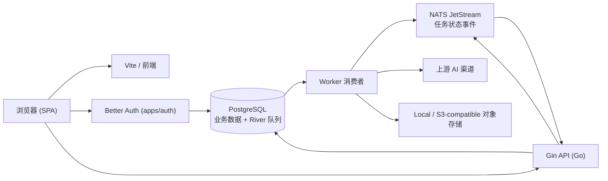
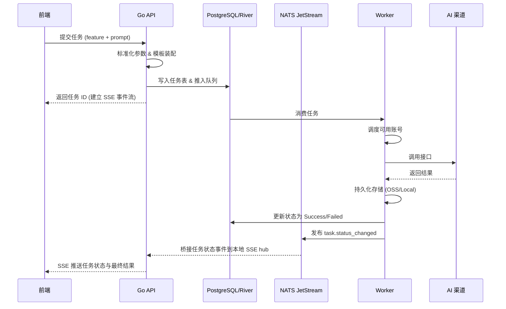

# <div align="center">IdeaBoard 开发手册</div>

<p align="center">
  <strong>面向仓库维护者与开发者的开发手册。</strong>
</p>

<p align="center">
  聚焦当前系统结构、workflow contract、本地开发路径与关键目录边界。
</p>

<p align="center">
  <code>私有</code>
  <code>闭源</code>
  <code>内部工程文档</code>
</p>

<p align="center">
  <a href="#development-snapshot">系统概览</a> ·
  <a href="#workflow-contract">工作流契约</a> ·
  <a href="#task-lifecycle">任务链路</a> ·
  <a href="#local-dev-fast-path">本地开发</a> ·
  <a href="#repo-map">目录边界</a>
</p>


> [!IMPORTANT]
> 本文档仅供 IdeaBoard 授权成员内部使用。项目为闭源私有项目，未经授权不得复制、分发或对外传播。

<a id="development-snapshot"></a>
## 开发概览

IdeaBoard 以画布工作流为中心组织产品语义。开发时应优先遵守 workflow feature contract、执行链 contract 和提示词模板 contract。

### 当前速览

| 维度 | 当前配置 |
|------|----------|
| 前端 | `Vue 3` + `Vite` + `TypeScript` + `PrimeVue v4` + `Tailwind CSS v4` + `Pinia` |
| 后端 | `Go` + `Gin` + `sqlc` + `Better Auth (Fastify/Node.js/TypeScript)` |
| 基础设施 | `PostgreSQL 17+`（业务数据与 River 任务队列）+ `NATS JetStream`（事件层） |
| 本地端口 | 前端 `5173`，Go API `6000`，Auth Service `6001`，NATS `4222/8222` |
| 当前主链 | 画布节点编排 -> 任务提交 -> Worker 执行 -> 结果回写 |
| 技术标识 | `ideaboard-*` |

### 架构形态




## 职责边界

### 前端职责

前端主要负责：

- 画布工作台、节点编排与连接交互
- 任务请求装配
- 结果展示与画板管理
- 管理后台配置页
- 登录态维护与权限路由

主要页面入口：

| 路径 | 说明 |
|------|------|
| `/user/home` | 用户首页与工作台入口 |
| `/user/picture` | 画布工作台主页面 |
| `/user/boards` | 画板列表 |
| `/user/center` | 用户中心 |
| `/admin/*` | 管理后台 |
| `/admin/statistics` | 运营统计仪表盘（调用趋势、模型占比、健康热力图） |

### 后端职责

后端主要负责：

- 用户鉴权与管理员权限控制
- 任务提交、任务记录与 SSE 状态推送
- 账号池、渠道商与任务调度
- 系统提示词模板读取与变量替换
- 分割、超分、向量化、上传与对象存储
- Worker 异步执行与结果持久化
- 每日统计聚合（事件源去重 + 回填）与运营仪表盘 API


<a id="workflow-contract"></a>
## 工作流契约

当前受支持的 workflow feature slug：

| 功能 slug | 典型语义 |
|-----------|----------|
| `sketch-to-image` | 草图成图 |
| `style-variation` | 风格延展 |
| `partial-edit` | 局部重绘 |
| `remove-bg` | 抠图 |
| `style-fusion` | 多图融合 |
| `pattern-gen` | 图案生成 |
| `hd-upscale` | HD |
| `image-extend` | 扩图 |

### 契约规则

- `feature` 应作为顶层任务字段传递，并在后端统一校验。
- `image_urls` 应作为顶层任务字段传递，不再在 `params` 里双轨存放。
- `params` 只承载 feature 专属参数，不再额外复制 `feature` 与 `image_urls`。
- 工作流参数只接受最新 canonical key，例如 `feature`、`upscale_mode`、`mask_image_url`、`reference_image_urls`。
- `use_mask`、`mask_image_url`、`mask_image_urls` 是 `partial-edit` 局部重绘链路的运行时边界参数，不是 prompt 模板变量。
- 已下线能力不进入产品文案、展示分组或模板 contract。

对应实现：

- [executionContract.ts](./apps/web/src/features/workspace/config/executionContract.ts)
- [features.go](./apps/api/internal/workflow/features.go)

<a id="task-lifecycle"></a>
## 任务生命周期

### 请求结构

前端通过统一执行 contract 拼装请求，典型字段如下：

```json
{
  "prompt": "用户提示词",
  "feature": "style-fusion",
  "image_urls": ["https://..."],
  "params": {
    "image_weights": [0.6, 0.4]
  }
}
```

### 前端入口

- [useFlowPromptGenerationOrchestrator.ts](./apps/web/src/features/workspace/composables/useFlowPromptGenerationOrchestrator.ts)
- [useFlowImageDirectActions.ts](./apps/web/src/features/workspace/composables/useFlowImageDirectActions.ts)
- [taskEvents.ts](./apps/web/src/shared/api/taskEvents.ts)
- [WorkspaceScreen.vue](./apps/web/src/features/workspace/screens/WorkspaceScreen.vue)

### 后端流程




关键代码：

- [service.go](./apps/api/internal/accounts/service.go)
- [engine.go](./apps/api/internal/prompts/engine.go)
- [consumer.go](./apps/api/internal/runtime/worker/consumer.go)


## 提示词系统

系统提示词由后台配置项 `feature_prompt:<slug>` 驱动，支持 `{{变量}}` 模板语法。

### 核心规则

- `feature slug` 是唯一索引，只接受当前 canonical slug。
- `{{user_prompt}}` 是用户输入信号，与系统提示词模板分层装配。
- `mode -> template` 映射仅保留必要项。
- 执行语义由后台模板和显式参数表达；后端不再注入不可见 hidden constraint 片段。
- Fusion 节点使用 `{{image_weights}}` 表达 2 到 4 张输入图的有序权重；旧的 A/B/ratio 变量已下线。
- Prompt 节点的 `pattern-gen` system prompt 是可选配置；为空时直接使用用户输入，后续可通过后台补充辅助性约束。

### 常用变量

| 变量 | 说明 |
|------|------|
| `{{user_prompt}}` | 用户输入文本 |
| `{{strength}}` | 风格延展强度百分比 |
| `{{image_weights}}` | Fusion 有序图片权重，例如 `Image 1: 60%, Image 2: 40%` |
| `{{extend_top}}` `{{extend_right}}` `{{extend_bottom}}` `{{extend_left}}` | 扩图参数 |
| `{{upscale_mode}}` | HD 增强模式 |
| `{{upscale_factor}}` | HD 倍数 |
| `{{output_format}}` | HD 输出格式 |
| `{{output_quality}}` | HD 输出质量 |

`original_image_url`、`image_urls`、`mask_image_url`、`mask_image_urls`、`reference_image_urls` 是运行时媒体字段，不是 prompt 模板变量；不要写成 `{{...}}` 插入 system prompt 正文。

相关入口：

- 管理页：[AdminPromptConfigPage.vue](./apps/web/src/features/admin/pages/prompt-config/AdminPromptConfigPage.vue)
- 后端装配：[engine.go](./apps/api/internal/prompts/engine.go)


## 鉴权与会话

系统采用 `Better Auth session + Go 业务授权模型`：

- 登录、注册、登出、session 校验由 `apps/auth` 负责。
- Go API 中间件读取 `Cookie`，通过 auth service 的 internal endpoint 校验 session。
- Go 仅维护本地业务用户档案（`id/username/auth_user_id/storage_uid/role/status`）与权限判定。
- 可在管理后台通过“开放注册”开关实时控制注册入口，状态持久化在 `system_configs` 表中。
- 可在管理后台通过“防刷限流设置”调整登录/注册入口限流参数，配置落在 `system_configs`（`auth_rate_limit_window`、`auth_rate_limit_max_requests`）。
- `apps/auth` 对 `/api/auth/sign-in/*` 与 `/api/auth/sign-up/*` 启用基于来源 IP 的内存限流；反向代理场景依赖 Fastify `request.ip` 与 loopback `trustProxy` 解析客户端 IP。
- `用户管理` 页当前支持：角色升降级、身份侧封禁/解封、会话吊销/踢下线、伪装登录/停止伪装、受控彻底注销；不开放后台改密。
- 角色升降级必须经由 Go Admin API：前端不直连 `authClient.admin.setRole`，由 Go 校验后同步 Auth Service 与业务侧 `users.role`。
- 彻底注销必须经由 Go Admin API：先校验目标不是当前管理员/管理员账号，再调用 Auth Service internal endpoint 删除身份、会话与凭据，最后清理业务侧用户数据；前端不得直接调用 `authClient.admin.removeUser`。
- 账号安全运维边界见 [AUTH_OPERATION_RUNBOOK.md](./docs/AUTH_OPERATION_RUNBOOK.md)，遵循“业务治理在 Admin，高风险身份操作由 Go Admin API 编排”的原则。

关键代码：

- [middleware.go](./apps/api/internal/auth/middleware.go)
- [service_client.go](./apps/api/internal/auth/service_client.go)
- [index.ts](./apps/auth/src/index.ts)
- [client.ts](./apps/web/src/shared/auth/client.ts)
- [user.ts](./apps/web/src/app/stores/user.ts)


<a id="local-dev-fast-path"></a>
## 本地开发快速路径

### 环境要求

| 组件 | 建议版本 |
|------|----------|
| Node.js | `22.18+` |
| Go | `1.26.4+` |
| PostgreSQL | `17+` |

### 启动步骤

1. 启动本地依赖：

```bash
cd docker
cp .env.example .env
# 至少修改 POSTGRES_PASSWORD
docker compose -f compose.local.yml up -d
```

2. 配置 auth 服务环境变量：

```bash
cd apps/auth
cp .env.example .env
```

3. 启动 auth 服务：

```bash
cd apps/auth
npm install
npm run migrate
npm run dev
```

> 启用 Better Auth Admin plugin 后必须先执行迁移：开发环境 `npm --prefix apps/auth run migrate`，生产环境 `npm --prefix apps/auth run migrate:dist`。不要手写 DDL，统一由 Better Auth migrate 管理字段变更。

4. 配置后端环境变量：

```bash
cd apps/api
cp .env.example .env
```

5. 启动后端：

```bash
cd apps/api
go run ./cmd
```

6. 启动前端：

```bash
cd apps/web
npm install
npm run dev
```

开发代理约定（`apps/web/vite.config.ts`）：

- `/api/auth/**` -> `http://localhost:6001`
- `/api/*` 与 `/uploads/*` -> `http://localhost:6000`

7. 初始化管理员：

```bash
cd apps/api
export INIT_ADMIN_PASSWORD='your-strong-password'
go run ./cmd init-admin
```

> [!IMPORTANT]
> `apps/api/.env` 与 `apps/auth/.env` 中的 `DB_USER / DB_PASSWORD` 是数据库连接账号，不是网站后台管理员账号。管理员登录账号来自 Better Auth 与本地 `users` 业务档案映射。
>
> `init-admin` 会调用 auth service 确保 Better Auth 存在 `admin` 账号，并绑定/创建本地 admin profile；执行该命令前请先启动 `apps/auth`。


## 验证矩阵

### 前端

```bash
cd apps/web
npm run lint -- --no-fix
npm run lint:style
npm run test:run
npm run build
```

### 后端

```bash
cd apps/api
go test ./...
go build ./...
```

### SQL 生成代码

`sqlc` 作为 Go module tool 固定在 `apps/api/go.mod`，不要依赖全局安装版本。修改 `apps/api/internal/db/queries` 或 `apps/api/internal/db/schema` 后执行：

```bash
cd apps/api
go tool sqlc generate
git diff --exit-code -- internal/db/sqlc
```

### 跨层改动

以下改动默认同时验证前后端：

- 路由
- 鉴权
- 任务 contract
- 上传
- 提示词模板
- 管理后台配置


## 环境变量

下面按常用程度拆开。日常本地开发和常规部署通常只需要看“常用配置”，其余多半是调优或基础设施接入时才会改。

### 常用配置

| 变量名 | 默认值 | 说明 |
|--------|--------|------|
| `DB_HOST` | `localhost` | PostgreSQL 主机 |
| `DB_PORT` | `5432` | PostgreSQL 端口 |
| `DB_USER` | `ideaboard` | PostgreSQL 用户 |
| `DB_PASSWORD` | 无默认值 | PostgreSQL 密码；使用仓库自带 Docker Compose 时读取 `docker/.env` 的 `POSTGRES_PASSWORD` |
| `DB_NAME` | `ideaboard` | 数据库名 |
| `DB_SSLMODE` | `disable` | PostgreSQL SSL 模式；本地与 Docker 内网默认关闭 |
| `APP_ENV` | `development` | 运行环境标识；生产环境必须显式设置为 `production` |
| `APP_PORT` | `6000` | 后端监听端口 |
| `APP_HOST` | 空 | 后端监听地址；反向代理部署建议设为 `127.0.0.1` |
| `APP_GIN_MODE` | `release` | Gin 运行模式，可选 `debug/release/test` |
| `APP_CORS_ALLOWED_ORIGINS` | `http://localhost:5173,http://127.0.0.1:5173` | CORS allowlist，多个 origin 用逗号分隔；生产同源访问通常留空，跨源直连 API 时必须显式配置 |
| `APP_PUBLIC_BASE_URL` | 空 | 对外前端地址，用于生成分享链接；Docker stack 默认由 `APP_BASE_URL` 注入 |
| `APP_PUBLIC_ASSET_BASE_URL` | 空 | 对外素材/API 地址，用于 `/uploads/*` 与上游模型可访问图片；Docker stack 默认由 `API_BASE_URL` 注入 |
| `AUTH_SERVICE_BASE_URL` | `http://127.0.0.1:6001` | Go 调用 auth service 的地址 |
| `AUTH_INTERNAL_KEY` | 空 | Go 调用 auth service internal endpoint 的保护密钥；必须与 Auth 服务同名变量一致 |

Docker compose / deploy 层的 `APP_BASE_URL` 与 `API_BASE_URL` 是输入变量，不是 API runtime 直接读取项。生产 stack 会把 `APP_BASE_URL` 映射到 `APP_PUBLIC_BASE_URL`、`APP_CORS_ALLOWED_ORIGINS` 与 `AUTH_TRUSTED_ORIGINS`，把 `API_BASE_URL` 映射到 `APP_PUBLIC_ASSET_BASE_URL` 与 `BETTER_AUTH_URL`。

Auth 服务关键变量：

| 变量名 | 默认值 | 说明 |
|--------|--------|------|
| `AUTH_HOST` | `127.0.0.1` | Auth 服务监听地址；生产建议仅监听回环地址 |
| `AUTH_PORT` | `6001` | Auth 服务监听端口 |
| `AUTH_INTERNAL_KEY` | 空 | Auth internal endpoint 保护密钥；生产必须设置为非占位随机值，并与 API 的同名变量一致 |
| `AUTH_TRUSTED_ORIGINS` | 空 | Better Auth 可信浏览器源 |
| `BETTER_AUTH_SECRET` | 本地开发 fallback | Better Auth 签名密钥；生产必须设置为非占位随机值，至少 32 字符高熵随机值 |
| `BETTER_AUTH_URL` | `http://localhost:5173`（本地开发） | Better Auth 对外基准 URL；生产必须设置为正式访问地址 |

### 高级调优

| 变量名 | 默认值 | 说明 |
|--------|--------|------|
| `DB_CONNECT_MAX_RETRIES` | `60` | API 启动时等待 PostgreSQL 就绪的最大重试次数 |
| `DB_CONNECT_RETRY_INTERVAL_MS` | `1000` | API 启动时 PostgreSQL 连接重试间隔 |
| `AUTH_SERVICE_TIMEOUT_SECONDS` | `5` | Go 调用 auth service 的超时秒数 |
| `RIVER_WORKER_CONCURRENCY` | `5` | River worker 并发数 |
| `RIVER_TASK_TIMEOUT_SECONDS` | `180` | River 任务执行保护超时 |
| `RIVER_NO_CAPACITY_RETRY_SECONDS` | `5` | 账号容量不足时 River snooze/retry 间隔 |
| `RIVER_MAX_RETRY` | `25` | River 基础设施级最大重试次数 |
| `NATS_URL` | 空 | NATS 服务地址；非空时默认启用 JetStream 事件层 |
| `NATS_EVENT_BUS_ENABLED` | 随 `NATS_URL` | 显式开启或关闭 JetStream 事件层 |
| `NATS_STREAM_NAME` | `IDEABOARD_EVENTS` | JetStream 事件 stream 名称 |
| `NATS_SUBJECT_PREFIX` | `ideaboard` | 事件 subject 前缀 |
| `NATS_CONSUMER_NAME` | 主机名派生 | 当前 API 实例的任务事件 consumer 名称 |
| `NATS_RETENTION_DAYS` | `7` | JetStream 事件保留天数 |
| `NATS_CONNECT_TIMEOUT_SECONDS` | `5` | NATS 初始连接超时 |
| `NATS_REQUEST_TIMEOUT_SECONDS` | `5` | JetStream API 请求超时 |
| `NATS_DRAIN_TIMEOUT_SECONDS` | `2` | NATS 连接关闭 drain 超时 |
| `ENV_FILE` | 空 | 可选，自定义 `.env` 路径 |


<a id="repo-map"></a>
## 仓库目录图

```text
.github/workflows/           # CI / release workflow
docker/                      # 本地数据库与开发环境
docs/                        # 设计、运行与约束文档
scripts/                     # 打包、部署与发布脚本

apps/web/src/
├── app/                      # 入口、router、store 装配
├── pages/                    # 路由级容器
├── features/                 # 领域模块
│   ├── workspace/            # 画布、节点与执行链路
│   │   └── components/nodes/ # 节点组件，内部按 config/utils/styles/composables 拆分
│   ├── boards/               # 画板列表、预览与同步
│   ├── admin/                # 管理后台
│   ├── auth/                 # 登录、注册与会话相关
│   ├── user/                 # 用户侧 layout 与壳层
│   └── profile/              # 用户中心
└── shared/                   # 共享 API、auth、composables、types、utils、assets
    └── api/generated-query/  # Orval 生成代码，不手动编辑

apps/api/
├── cmd/                      # 服务入口
├── internal/platform/        # 基础设施：config、database、response、safehttp
├── internal/runtime/         # 启动、HTTP 路由、队列与 worker
├── internal/auth/            # 鉴权中间件与 auth service client
├── internal/users/           # 用户管理
├── internal/accounts/        # 账号池与任务调度
├── internal/boards/          # 画板管理
├── internal/channels/        # 渠道管理
├── internal/tasks/           # 任务模型与状态
├── internal/workflow/        # feature contract
├── internal/prompts/         # 提示词模板与装配
├── internal/storage/         # 对象存储配置与实现
├── internal/assets/          # 线稿模式等业务模板
└── internal/imageproc/       # 分割、线稿、向量化等图片处理

apps/auth/
├── src/auth.ts               # Better Auth 配置
├── src/env.ts                # 环境变量与生产校验
├── src/index.ts              # /api/auth 与子路径、/internal/* 路由
└── .env.example              # auth 服务环境变量模板
```


## 维护规则

在继续迭代时，优先遵守以下规则：

1. 以 working tree 为准，不回滚用户未提交改动。
2. 改任务 contract 时，优先同步前端执行链、后端 canonical helper 和 admin 配置页。
3. 已下线能力不应继续出现在产品文案、模板 contract 或展示分组里。
4. 跨层变更默认需要同时验证前端与后端。
