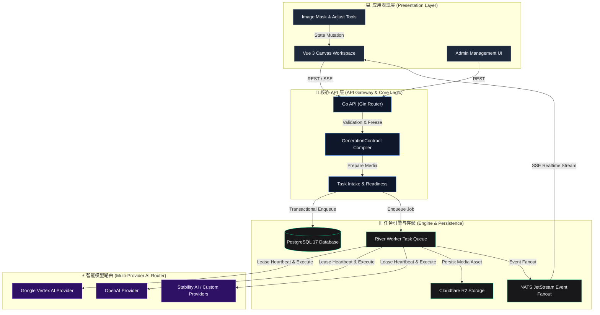
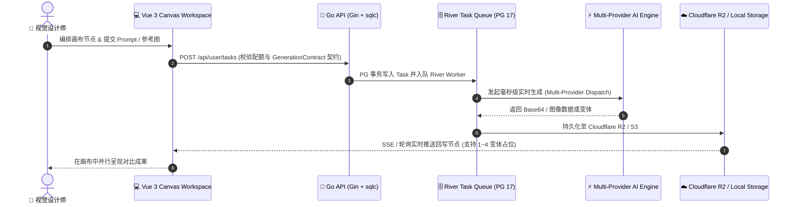

# IdeaBoard

<p align="center">
  
</p>

<p align="center">
  <strong>面向视觉设计师与电商场景的高性能 AI 画布工作流平台</strong><br>
  <em>Next-Generation AI Canvas for Visual Designers to Explore, Compare & Refine Image Directions in One Workspace.</em>
</p>

<p align="center">
  <a href="https://ideaboard.art"></a>
  <a href="#-技术栈矩阵-tech-stack-matrix"></a>
  <a href="#-核心处理主链路-end-to-end-sequence"></a>
  <a href="#-四层架构组件分层-system-architecture-flow"></a>
</p>

> [!NOTE]
> **IdeaBoard** 打破了传统单图生成的线性对话束缚。它引入无边界 **Visual Canvas Workspace**，允许设计师在同一个画布中并排比对图案方向、执行局部重绘、多图融合以及 4K 高清渲染。

---

## 📸 核心界面预览 (Workspace Preview)

<p align="center">
  
</p>

---

## 🍱 核心能力 Bento Grid 网格矩阵 (Key Highlights)

| 核心特性 | 架构能力 | 商业与工程价值 |
| :--- | :--- | :--- |
| 🎨 **无限 AI 画布** *(Infinite Canvas)* | Vue Flow 可视化节点编排、连接线自动引流、多任务并行渲染 | 告别线性对话束缚，提供网格对比与无边界视觉探索 |
| 🔀 **多模型智能路由** *(Multi-Provider Router)* | 统一 `GenerationContract` 契约，支持 Google Vertex AI、OpenAI、Stability AI 等 Provider | 无缝支持预设与 `Auto` 原生尺寸，高清晰度与风格多变 |
| 🚀 **极速无锁任务队列** *(High-Perf Queue)* | PostgreSQL 17 事务入队 + River Worker 调度，带心跳与续租 | 数据库事务写入，零脏数据，长任务与多变体生成绝不误杀 |
| 💰 **按比例 Partial 结算** *(Partial Settlement)* | 按实际成功输出的图片张数精准扣费，未成功变体自动秒级退款 | 杜绝“成功一部分全额扣费”的坏体验，精准保障用户权益 |
| 💳 **灵活 Credit 计量与配额** *(Pricing & Quota)* | 灵活的 Credit 积分扣减与配额管理，支持多节点动态计费系数 | 健全的商业化计费体系，支持额度管控、充值与配额审计 |
| 🛡️ **企业级安全与存储** *(Sec & Infra)* | Better Auth、OTP 验证、Google OAuth 2.0、Cloudflare R2 / WAF 防线 | 零信任架构、安全密钥转义、资产持久化与全球 CDN 加速 |

---

## 📐 核心架构与四层拓扑 (4-Tier Architecture Topology)

### 1️⃣ 四层架构组件分层 (System Architecture Flow)



### 2️⃣ 任务提交与处理主链路 (End-to-End Sequence)



---

## 💻 技术栈矩阵 (Tech Stack Matrix)

<p align="left">
  <!-- Frontend -->
  
  
  
  
  
  <!-- Backend -->
  
  
  
  
  <!-- Storage & Infra -->
  
  
  
  
</p>

| 服务层级 | 技术选型与用途 |
| :--- | :--- |
| **Web Frontend** | Vue 3 (Composition API), Vite, TypeScript, Tailwind CSS v4, PrimeVue v4, Vue Flow |
| **Go API Backend** | Go 1.26+, Gin Framework, sqlc (Typed Query Engine), River Queue (PG 17 Native Queue) |
| **Auth Service** | Better Auth, Fastify, TypeScript, OTP & Google OAuth 2.0 |
| **Database & Cache** | PostgreSQL 17 (Triggers, JSONB, Composite Indexes), Usage Per-process LRU Cache |
| **Message & Events** | NATS JetStream (Audit Trail & Event Fanout), SSE Realtime Adapter |
| **Deploy & Infra** | Cloudflare Pages, VPS Reverse Proxy, Docker Compose, GHCR Registry |

---

## ⚡ 本地服务端口地图 (Default Ports)

| 服务层级 | 服务名称 | 本地监听端口 | 访问说明 / 健康检查 |
| :--- | :--- | :--- | :--- |
| **Web Frontend** | `apps/web` | `http://localhost:5173` | Vue 3 SPA 画布界面与 Admin 登录 |
| **Go API** | `apps/api` | `http://localhost:6000` | `/api/health` 核心业务与 Task 接口 |
| **Auth Service** | `apps/auth` | `http://localhost:6001` | `/api/health` 认证与 OAuth 回调服务 |
| **NATS Event** | `NATS` | `4222` / `8222` | 事件广播与实时 Fanout 服务 |

---

## 🛠️ 快速开始 (Quickstart Guide)

> [!TIP]
> **环境要求**：Node.js `>= 22.23.2` \| Go `>= 1.26.5` \| PostgreSQL `>= 17`

<details open>
<summary><b>1️⃣ 启动本地数据库与依赖 (Docker Compose)</b></summary>

```bash
cd docker
cp .env.example .env
cp migration.env.example migration.env
docker compose -f compose.local.yml up -d
```
</details>

<details open>
<summary><b>2️⃣ 初始化数据库 Schema 与 Auth 服务</b></summary>

```bash
# 初始化 Go API Schema
cd apps/api && cp .env.example .env
set -a && source ../../docker/migration.env && set +a
go run ./cmd migrate

# 初始化并启动 Auth 服务
cd ../auth && cp .env.example .env
npm install
set -a && source ../../docker/migration.env && set +a
npm run migrate && npm run dev
```
</details>

<details open>
<summary><b>3️⃣ 启动 Go API 与 Web 前端</b></summary>

```bash
# 启动 Go API Backend (端口 :6000)
cd apps/api && go run ./cmd

# 启动 Web 前端 (端口 :5173)
cd apps/web && npm install && npm run dev
```
</details>

<details>
<summary>🔑 <b>点击展开：初始化超级管理员账号命令</b></summary>

```bash
cd apps/api
INIT_ADMIN_EMAIL='admin@ideaboard.art' \
INIT_ADMIN_DISPLAY_NAME='Admin' \
INIT_ADMIN_PASSWORD='your-strong-password' \
  go run ./cmd init-admin
```
*注：`INIT_ADMIN_PASSWORD` 必须为 10–128 个字符；命令执行前 Auth Service 必须已启动。*
</details>

---

## 📂 仓库架构结构 (Repository Structure)

```text
IdeaBoard/
├── 📁 apps/
│   ├── 💻 web/                  # Vue 3 SPA、Canvas Workspace、Admin UI
│   ├── 🚀 api/                  # Go API、Tasking Worker、Multi-Provider AI Adapters
│   └── 🔒 auth/                 # Better Auth 服务
├── 📁 .github/
│   ├── workflows/            # GitHub Actions CI/CD 流水线 (api, web, auth, docker)
│   └── actions/              # 自定义部署 Action 模块
├── 📁 docker/                   # 本地开发与生产 Docker Compose 编排
├── 📁 deploy/                   # Nginx 反向代理与 Cloudflare WAF 配置
├── 📁 scripts/                  # CI 校验、Migration 契约与部署自动化脚本
└── 📁 docs/                     # 架构文档、部署 Runbooks 与视觉资产
```

---

## 📖 核心文档入口 (Documentation Sitemap)

| 文档 | 说明与用途 |
| :--- | :--- |
| 📘 [DESIGN.md](./DESIGN.md) | 系统设计、模块边界、关键 invariants |
| 🛠️ [DEVELOPMENT.md](./DEVELOPMENT.md) | 本地开发指南、代码入口与验证矩阵 |
| 🎨 [apps/web/DESIGN.md](./apps/web/DESIGN.md) | Agent 做前端 UI 改动时的规范与 UI 执行协议 |
| 🚢 [docs/runbooks/deployment.md](./docs/runbooks/deployment.md) | Cloudflare + Docker Compose 部署、升级与回滚 Runbook |
| 🔐 [docs/runbooks/auth-operations.md](./docs/runbooks/auth-operations.md) | Auth 运营与高风险身份操作边界 |
| 🛡️ [docs/runbooks/data-protection.md](./docs/runbooks/data-protection.md) | PostgreSQL backup/restore 与密钥材料处理 |

---

## 🧪 自动化测试验证 (Verification)

运行日常最小验证集：
```bash
cd apps/web && npm run test:run      # 前端单元测试
cd apps/api && go test ./...         # 后端 Go 单元测试
```

---

<p align="center">
  <sub>本项目为闭源私有项目，未经授权不得复制、分发或使用。保留所有权利。</sub><br>
  <sub>Copyright © 2026 IdeaBoard. All rights reserved.</sub>
</p>
