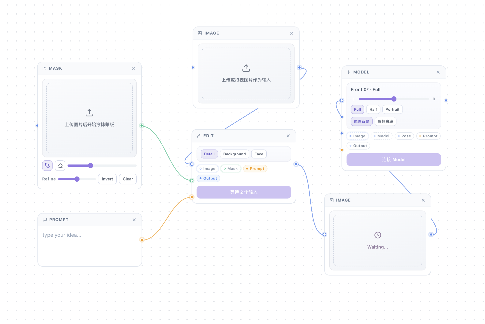
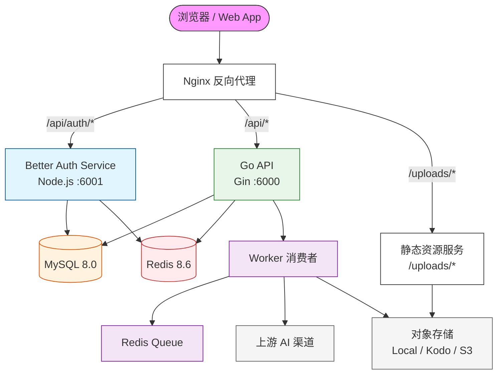

<p align="center">
  
</p>

<p align="center">
  <strong>为服装设计与商品展示场景构建的 AI 画布工作流平台。</strong>
</p>

<p align="center">
  在统一画布中完成素材输入、节点编排、任务执行、结果沉淀与后台配置。
</p>

<p align="center">
  
  
  
</p>

<p align="center">
  <a href="#overview">项目概览</a> ·
  <a href="#highlights">核心亮点</a> ·
  <a href="#capabilities">能力范围</a> ·
  <a href="#quick-start">快速开始</a> ·
  <a href="#deployment">部署说明</a> ·
  <a href="#docs">相关文档</a>
</p>

<p align="center">
  
  
  
  
  
  <br/>
  
  
  
  
  <br/>
  
  
  
</p>

<p align="center">
  <a href="https://dash.cloudflare.com/?to=/:account/workers-and-pages/create/pages">
    
  </a>
</p>

<a id="product-preview"></a>
## 产品预览

<p align="center">
  
</p>

<p align="center">
  <sub>统一画布工作流：输入、编辑、参数控制与输出回写在同一界面完成。</sub>
</p>

<a id="overview"></a>
## 项目概览

IdeaBoard 是一套围绕 AI 设计工作流打造的全栈系统。前端提供节点画布、任务入口与管理后台，后端负责鉴权、任务落库、提示词模板装配、账号调度、异步执行、结果持久化，以及 `Local / Kodo / S3-compatible` 存储配置接入。

### 产品快照

| 维度 | 当前配置 |
|------|----------|
| 默认本地端口 | 前端 `5173`，Go API `6000`，Auth Service `6001` |
| 运行方式 | 本地开发、Cloudflare Pages + VPS Docker Compose、标准 Linux 部署 |
| 核心界面 | 用户画布工作台、画板管理、管理后台 |

### 系统架构



生产环境推荐由 Cloudflare Pages 托管前端，VPS 上的 Docker Compose stack 运行 Gateway、Go API、Better Auth、MySQL 与 Redis，并由 Cloudflare Tunnel 暴露 API 域名。

<a id="highlights"></a>
## 核心亮点

<table>
  <tr>
    <td valign="top" width="50%">
      <strong>画布工作流</strong><br/>
      以节点编排为中心，统一管理输入、连接、执行与结果回写。
    </td>
    <td valign="top" width="50%">
      <strong>任务运行时</strong><br/>
      任务异步执行，支持队列调度、账号池分发与 SSE 状态推送。
    </td>
  </tr>
  <tr>
    <td valign="top">
      <strong>提示词系统</strong><br/>
      支持按 feature 维度配置系统提示词与模板变量。
    </td>
    <td valign="top">
      <strong>管理控制台</strong><br/>
      管理用户、账号、渠道、统计仪表盘、线稿模式、提示词与配置项。
    </td>
  </tr>
</table>

<a id="capabilities"></a>
## 能力范围

当前产品主链路覆盖以下能力：

<table>
  <tr>
    <td valign="top" width="33%">
      <strong>设计生成</strong><br/>
      草图成图、风格延展、图案生成
    </td>
    <td valign="top" width="33%">
      <strong>编辑调整</strong><br/>
      局部改款、局部重绘、双图融合
    </td>
    <td valign="top" width="33%">
      <strong>图片工具</strong><br/>
      局部重绘、图片延伸、HD
    </td>
  </tr>
  <tr>
    <td valign="top">
      <strong>展示与视角</strong><br/>
      单视角展示、商品展示
    </td>
    <td valign="top">
      <strong>运营统计</strong><br/>
      调用聚合、模型占比、健康热力图
    </td>
    <td valign="top">
      <strong>存储接入</strong><br/>
      本地存储、Kodo、S3-compatible
    </td>
  </tr>
  <tr>
    <td valign="top">
      <strong>身份认证</strong><br/>
      登录、注册、会话、角色、封禁
    </td>
    <td valign="top">
      <strong>任务调度</strong><br/>
      队列、账号池、失败重试、模型解析
    </td>
    <td valign="top"></td>
  </tr>
</table>

更细的 workflow feature contract、提示词模板变量与执行链路说明见 [DEVELOPMENT.md](./DEVELOPMENT.md)。如需按 feature 配置管理后台系统提示词，可参考 [SYSTEM_PROMPT.md](./SYSTEM_PROMPT.md)。

<a id="quick-start"></a>
## 快速开始

### 环境要求

| 组件 | 版本 |
|------|------|
| Node.js | `22.18+` |
| Go | `1.25+` |
| MySQL | `8.0+` |
| Redis | `8.6+` |

### 1. 启动本地依赖

```bash
cd docker
docker compose up -d
```

<details>
<summary>默认本地依赖配置</summary>

| 项目 | 默认值 |
|------|--------|
| MySQL Root 密码 | `root123` |
| 业务数据库 | `ideaboard` |
| 业务用户 | `ideaboard` |
| 业务密码 | `ideaboard123` |
| Redis | `127.0.0.1:6379` |

</details>

> [!NOTE]
> `docker compose` 默认只绑定到本机回环地址 `127.0.0.1`，避免把 MySQL / Redis 直接暴露到外网。若你需要 Redis 密码，可在 `docker/.env` 中设置 `REDIS_PASSWORD`，并在 `apps/api/.env` 中同步设置 `REDIS_AUTH`。

### 2. 配置后端环境

```bash
cd apps/api
cp .env.example .env
```

> [!TIP]
> 至少确认数据库、Redis、端口以及 `AUTH_SERVICE_BASE_URL` / `AUTH_SERVICE_INTERNAL_KEY` 配置正确。`.env.example` 里的敏感字段是空值或占位值，不应直接用于部署。

如果后端放在 Nginx / 宝塔等反向代理后面，建议额外设置：

```env
APP_HOST=127.0.0.1
```

这样 `ideaboard-server` 只监听本机回环地址，避免被绕过代理直接访问。

### 3. 启动 Auth 服务

```bash
cd apps/auth
cp .env.example .env
npm install
npm run migrate
npm run dev
```

生产部署时必须设置 `BETTER_AUTH_SECRET`（至少 32 字符高熵随机值）和 `BETTER_AUTH_URL`（正式访问地址），并让 `AUTH_INTERNAL_KEY` 与 Go API 的 `AUTH_SERVICE_INTERNAL_KEY` 保持一致。

> [!IMPORTANT]
> 启用 Better Auth Admin plugin 后，请先执行 `npm --prefix apps/auth run migrate`（生产环境执行 `npm --prefix apps/auth run migrate:dist`），以补齐 `user.role`、`user.banned`、`user.banReason`、`user.banExpires` 与 `session.impersonatedBy` 等字段。

<details>
<summary>Auth 服务能力说明</summary>

- 身份侧高级管理入口：后台 `用户管理` 页。
- 当前支持：角色升降级、身份侧封禁/解封、会话吊销/踢下线、伪装登录/停止伪装、受控彻底注销、开放注册开关、防刷限流设置。
- 仍不开放：后台改密；彻底注销必须经由 Go Admin API 编排，不允许前端直连 Better Auth 删除身份数据。

</details>

### 4. 启动后端（Go API）

```bash
cd apps/api
go run ./cmd
```

### 5. 启动前端

```bash
cd apps/web
npm install
npm run dev
```

<details>
<summary>开发环境代理说明</summary>

- `apps/web/vite.config.ts` 已将 `/api/auth` 代理到 `http://localhost:6001`
- 其余 `/api/*` 与 `/uploads/*` 仍代理到 `http://localhost:6000`

</details>

### 6. 初始化管理员账号

```bash
cd apps/api
INIT_ADMIN_PASSWORD='your-strong-password' go run ./cmd init-admin
```

- 用户名：`admin`
- 密码：由 `INIT_ADMIN_PASSWORD` 指定

> [!IMPORTANT]
> `init-admin` 会调用 auth service 确保 Better Auth 存在 `admin` 账号，并绑定/创建本地 admin profile。执行该命令前请先启动 `apps/auth`。

### 本地访问地址

| 地址 | 用途 |
|------|------|
| `http://localhost:5173` | 前端开发环境 |
| `http://localhost:5173/admin/login` | 管理后台登录 |
| `http://localhost:6000/api/health` | 后端健康检查 |
| `http://localhost:6001/api/health` | Better Auth 健康检查 |

## 仓库结构

```text
IdeaBoard/
├── apps/
│   ├── web/                  # Vue 3 前端与管理后台
│   │   └── src/features/     # 业务模块（workspace、admin、user、profile 等）
│   ├── auth/                 # Better Auth 服务（登录/注册/session）
│   └── api/                  # Go API、任务、Worker、服务逻辑
│       └── internal/         # 领域包（accounts、channels、users、workflow 等）
├── docs/                     # 架构约束与补充文档
├── docker/                   # 本地依赖与生产 Docker Compose
├── scripts/                  # 打包与部署脚本
└── *.md                      # README、DEVELOPMENT、DEPLOYMENT、CHANGELOG
```

<a id="deployment"></a>
## 部署说明

### 推荐部署：Cloudflare Pages + GHCR + Docker Compose

首次 VPS 初始化 + 部署：

```bash
curl -fsSL https://raw.githubusercontent.com/Ericsunsk/IdeaBoard/main/scripts/bootstrap-vps.sh | bash
```

后续部署 / 升级：

```bash
ideaboard update
```

详见 [DEPLOYMENT.md](./DEPLOYMENT.md)。

### Cloudflare Pages + Tunnel + VPS

适用于前端部署到 Cloudflare Pages，后端、认证服务、MySQL 与 Redis 继续运行在 VPS，并通过 Cloudflare Tunnel 暴露 `api.example.com` 的混合部署。

<p>
  <a href="https://dash.cloudflare.com/?to=/:account/workers-and-pages/create/pages">
    
  </a>
</p>

Pages 配置：

| 项目 | 值 |
|------|----|
| Root directory | `apps/web` |
| Build command | `npm run build` |
| Build output directory | `dist` |
| Environment variable | `NODE_VERSION=22.18.0` |
| Environment variable | `VITE_API_BASE_URL=https://api.example.com/api` |
| Environment variable | `VITE_AUTH_BASE_URL=https://api.example.com` |

VPS 侧设置 `APP_PUBLIC_BASE_URL=https://app.example.com` 与 `APP_PUBLIC_ASSET_BASE_URL=https://api.example.com`；Cloudflare Tunnel 将 `api.example.com` 转发到 VPS 本机 Gateway，例如 `http://127.0.0.1:8080`。

### 传统 Linux 部署

仍保留 `systemd + Nginx` 发布包方式，适合不使用 Docker 的服务器环境。

```bash
./scripts/package-deploy.sh
```

> [!NOTE]
> Cloudflare 官方 `Deploy to Cloudflare` 一键按钮目前面向 Workers 应用；本项目此形态使用 Pages 托管 Vue 前端，因此 README 按钮跳转到 Pages 创建入口。

<a id="docs"></a>
## 相关文档

| 文档 | 用途 |
|------|------|
| [DEVELOPMENT.md](./DEVELOPMENT.md) | 架构、contract、本地开发与目录边界 |
| [SYSTEM_PROMPT.md](./SYSTEM_PROMPT.md) | Feature System Prompt 配置手册与推荐模板 |
| [DEPLOYMENT.md](./DEPLOYMENT.md) | Cloudflare + Docker Compose、传统 Linux 部署、升级与回滚 |
| [docs/AUTH_OPERATION_RUNBOOK.md](./docs/AUTH_OPERATION_RUNBOOK.md) | Auth 运维边界与应急流程 |
| [docs/architecture-constraints.md](./docs/architecture-constraints.md) | 目录边界与命名约束 |
| [docker/README.md](./docker/README.md) | Docker 本地依赖与生产 stack 说明 |
| [CHANGELOG.md](./CHANGELOG.md) | 发布记录 |

## 验证建议

上线前建议至少确认：

1. `curl http://127.0.0.1:6000/api/health` 返回成功。
2. `curl http://127.0.0.1:6001/api/health` 返回成功。
3. 用户端首页可正常访问。
4. 管理员可登录后台。
5. 图片上传与结果回写正常。
6. 任务提交后能看到完整状态流转。

<p align="center">
  <sub>本项目为闭源私有项目，未经授权不得复制、分发或使用。保留所有权利。</sub>
</p>
