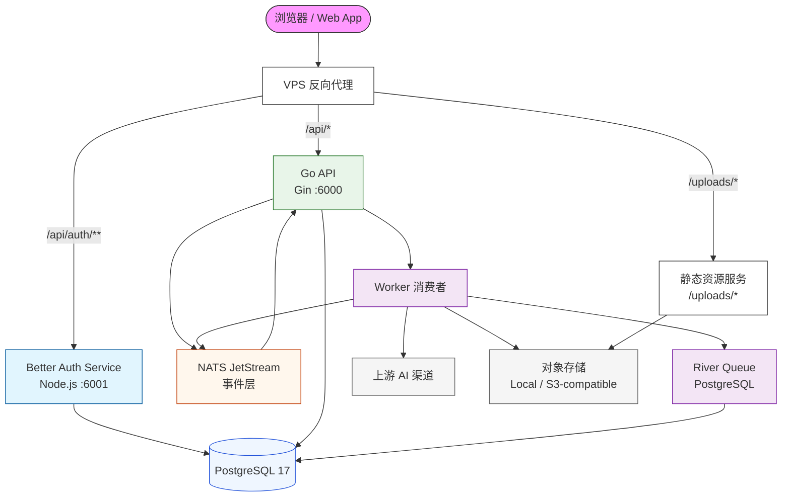

<p align="center">
  
</p>

<p align="center">
  <strong>为图像设计与电商展示场景构建的 AI 画布工作流平台。</strong>
</p>

<p align="center">
  在统一画布中完成素材输入、节点编排、任务执行、结果沉淀与后台配置。
</p>

<p align="center">
  
  
  
</p>

<p align="center">
  <a href="#overview">项目概览</a> ·
  <a href="#highlights">核心亮点</a> ·
  <a href="#capabilities">能力范围</a> ·
  <a href="#quick-start">快速开始</a> ·
  <a href="#deployment">部署说明</a> ·
  <a href="#docs">相关文档</a>
</p>

<p align="center">
  
  
  
  
  
  
  <br/>
  
  
  
  
  <br/>
  
  
</p>

<p align="center">
  <a href="https://dash.cloudflare.com/?to=/:account/workers-and-pages/create/pages">
    
  </a>
</p>

<a id="product-preview"></a>

## 产品预览

<p align="center">
  
</p>

<p align="center">
  <sub>统一画布工作流：输入、编辑、参数控制与输出回写在同一界面完成。</sub>
</p>

<a id="overview"></a>

## 项目概览

IdeaBoard 是一套围绕 AI 设计工作流打造的全栈系统。前端提供节点画布、任务入口与管理后台，后端负责鉴权、任务落库、提示词模板装配、账号调度、异步执行、结果持久化，以及 `Local / S3-compatible` 存储配置接入。

### 产品快照

| 维度         | 当前配置                                                         |
| ------------ | ---------------------------------------------------------------- |
| 默认本地端口 | 前端 `5173`，Go API `6000`，Auth Service `6001`，NATS `4222/8222` |
| 运行方式     | 本地开发、Cloudflare Pages + VPS Docker Compose |
| 核心界面     | 用户画布工作台、画板管理、管理后台                               |

### 系统架构



生产环境推荐由 Cloudflare Pages 托管前端，Cloudflare DNS/Proxy 指向 VPS 宿主机反代服务，VPS 上的 Docker Compose stack 运行 Go API、Better Auth、PostgreSQL 与 NATS JetStream。任务队列由 River 写入 PostgreSQL；JetStream 只承载任务状态事件、audit 与实时 fanout，不作为任务队列。

<a id="highlights"></a>

## 核心亮点

<table>
  <tr>
    <td valign="top" width="50%">
      <strong>画布工作流</strong><br/>
      以节点编排为中心，统一管理输入、连接、执行与结果回写。
    </td>
    <td valign="top" width="50%">
      <strong>任务运行时</strong><br/>
      任务异步执行，支持队列调度、账号池分发与 SSE 状态推送。
    </td>
  </tr>
  <tr>
    <td valign="top">
      <strong>提示词系统</strong><br/>
      支持按 feature 维度配置系统提示词与模板变量。
    </td>
    <td valign="top">
      <strong>管理控制台</strong><br/>
      管理用户、账号、渠道、统计仪表盘、线稿模式、提示词与配置项。
    </td>
  </tr>
</table>

<a id="capabilities"></a>

## 能力范围

当前产品主链路覆盖以下能力：

<table>
  <tr>
    <td valign="top" width="33%">
      <strong>设计生成</strong><br/>
      草图成图、风格延展、图案生成
    </td>
    <td valign="top" width="33%">
      <strong>编辑调整</strong><br/>
      局部重绘、多图融合
    </td>
    <td valign="top" width="33%">
      <strong>图片工具</strong><br/>
      扩图、HD
    </td>
  </tr>
  <tr>
    <td valign="top">
      <strong>画板与结果</strong><br/>
      结果预览、画板管理
    </td>
    <td valign="top">
      <strong>运营统计</strong><br/>
      调用聚合、模型占比、健康热力图
    </td>
    <td valign="top">
      <strong>存储接入</strong><br/>
      本地存储、S3-compatible
    </td>
  </tr>
  <tr>
    <td valign="top">
      <strong>身份认证</strong><br/>
      登录、注册、会话、角色、封禁
    </td>
    <td valign="top">
      <strong>任务调度</strong><br/>
      队列、账号池、失败重试、模型解析
    </td>
    <td valign="top"></td>
  </tr>
</table>

更细的 workflow feature contract、提示词模板变量与执行链路说明见 [DEVELOPMENT.md](./DEVELOPMENT.md)。如需按 feature 配置管理后台系统提示词，可参考 [SYSTEM_PROMPT.md](./SYSTEM_PROMPT.md)。

<a id="quick-start"></a>

## 快速开始

### 环境要求

| 组件    | 版本     |
| ------- | -------- |
| Node.js | `22.18+` |
| Go      | `1.26.4+` |
| PostgreSQL | `17+` |

### 1. 启动本地依赖

```bash
cd docker
cp .env.example .env
# 至少修改 POSTGRES_PASSWORD
docker compose -f compose.local.yml up -d
```

<details>
<summary>本地依赖配置</summary>

| 项目            | 默认值           |
| --------------- | ---------------- |
| 业务数据库      | `${POSTGRES_DB:-ideaboard}` |
| 业务用户        | `${POSTGRES_USER:-ideaboard}` |
| 业务密码        | `docker/.env` 中的 `POSTGRES_PASSWORD` |
| 任务队列        | River + PostgreSQL |
| 事件层          | NATS JetStream |

</details>

> [!NOTE]
> `docker compose` 默认只绑定到本机回环地址 `127.0.0.1`，避免把 PostgreSQL 与 NATS 直接暴露到外网。
> 当前后端只支持 PostgreSQL；部署脚本不会自动转换其他数据库形态的数据。

### 2. 配置后端环境

```bash
cd apps/api
cp .env.example .env
```

> [!TIP]
> 至少确认数据库、端口、`AUTH_SERVICE_BASE_URL` / `AUTH_INTERNAL_KEY` 以及 `APP_SECRETS_ENCRYPTION_KEY` 配置正确。`.env.example` 里的敏感字段是空值或占位值，不应直接用于部署。

如果后端放在 Nginx / 宝塔等反向代理后面，建议额外设置：

```env
APP_HOST=127.0.0.1
```

这样 `ideaboard-server` 只监听本机回环地址，避免被绕过代理直接访问。

### 3. 初始化 API 业务库

```bash
cd apps/api
go run ./cmd migrate
```

API 启动时仍会自动补跑 migration；显式执行一次能让本地、Docker 和生产部署都保持 “API baseline first, Auth migration second” 的顺序。非空数据库迁入、reset 与 restore 规则见 [DEPLOYMENT.md#api-database-baseline](./DEPLOYMENT.md#api-database-baseline)。

### 4. 启动 Auth 服务

```bash
cd apps/auth
cp .env.example .env
npm install
npm run migrate
npm run dev
```

本地开发如果暂时不配置 `AUTH_INTERNAL_KEY`，必须显式设置 `AUTH_INSECURE_DEV=1`，且 `AUTH_HOST` 保持为 `127.0.0.1`、`localhost` 或 `::1` 这类 loopback 地址。API 服务必须设置 `APP_SECRETS_ENCRYPTION_KEY`（使用 `openssl rand -base64 32` 生成）。生产部署时必须设置 `BETTER_AUTH_SECRET`（至少 32 字符高熵随机值）和 HTTPS 的 `BETTER_AUTH_URL`（正式访问地址），并让 API 与 Auth 服务使用相同的 `AUTH_INTERNAL_KEY`。

> [!IMPORTANT]
> 启用 Better Auth Admin plugin 后，请先执行 `npm --prefix apps/auth run migrate`（直接部署 Auth 构建产物时先 build 再执行 `migrate:dist`），以补齐 `user.role`、`user.banned`、`user.banReason`、`user.banExpires` 与 `session.impersonatedBy` 等字段。迁移脚本使用当前项目安装的 `better-auth` runtime，Docker stack 会通过已签名的 `ideaboard-auth-migrate` 镜像运行迁移。

<details>
<summary>Auth 服务能力说明</summary>

- 身份侧高级管理入口：后台 `用户管理` 页。
- 当前支持：角色升降级、身份侧封禁/解封、会话吊销/踢下线、伪装登录/停止伪装、受控彻底注销、开放注册开关、防刷限流设置。
- 仍不开放：后台改密；彻底注销必须经由 Go Admin API 编排，不允许前端直连 Better Auth 删除身份数据。

</details>

### 5. 启动后端（Go API）

```bash
cd apps/api
go run ./cmd
```

### 6. 启动前端

```bash
cd apps/web
npm install
npm run dev
```

<details>
<summary>开发环境代理说明</summary>

- `apps/web/vite.config.ts` 已将 `/api/auth` 代理到 `http://localhost:6001`
- 其余 `/api/*` 与 `/uploads/*` 仍代理到 `http://localhost:6000`

</details>

### 7. 初始化管理员账号

```bash
cd apps/api
INIT_ADMIN_PASSWORD='your-strong-password' go run ./cmd init-admin
```

- 用户名：`admin`
- 密码：由 `INIT_ADMIN_PASSWORD` 指定

> [!IMPORTANT]
> `init-admin` 会调用 auth service 确保 Better Auth 存在 `admin` 账号，并绑定/创建本地 admin profile。执行该命令前请先启动 `apps/auth`。

### 本地访问地址

| 地址                                | 用途                 |
| ----------------------------------- | -------------------- |
| `http://localhost:5173`             | 前端开发环境         |
| `http://localhost:5173/admin/login` | 管理后台登录         |
| `http://localhost:6000/api/health`  | 后端健康检查         |
| `http://localhost:6001/api/health`  | Better Auth 健康检查 |

## 仓库结构

```text
IdeaBoard/
├── apps/
│   ├── web/                  # Vue 3 前端与管理后台
│   │   └── src/features/     # 业务模块（canvas、admin、user、profile 等）
│   ├── auth/                 # Better Auth 服务（登录/注册/session）
│   └── api/                  # Go API、任务、Worker、服务逻辑
│       └── internal/         # 领域包（accounts、channels、users、workflow 等）
├── docs/                     # 架构约束与补充文档
├── deploy/                   # Nginx 等生产部署模板
├── docker/                   # 本地依赖与生产 Docker Compose
├── scripts/                  # 打包与部署脚本
└── *.md                      # README、DEVELOPMENT、DEPLOYMENT、CHANGELOG
```

<a id="deployment"></a>

## 部署说明

### 推荐部署：Cloudflare Pages + GHCR + Docker Compose

后端镜像由 [docker-images.yml](./.github/workflows/docker-images.yml) 发布到 GHCR；发布路径会生成 SBOM、执行 Grype 高危漏洞 gate，并用 Cosign keyless 签名。漏洞 triage 与人工验签命令见 [DEPLOYMENT.md](./DEPLOYMENT.md#recommended-docker)。

首次 VPS 初始化 + 部署（`--ref` 为可选，默认自动拉取最新 Release Tag 或 `main` 分支；支持私有仓库一键运行）：

```bash
export GITHUB_TOKEN="your-github-token" && curl -fsSL -H "Authorization: token ${GITHUB_TOKEN}" -H "Accept: application/vnd.github.raw" "https://api.github.com/repos/Ericsunsk/IdeaBoard/contents/scripts/bootstrap-vps.sh" -o /tmp/bootstrap-vps.sh && bash /tmp/bootstrap-vps.sh
# 若为 fork 或自建仓库，请将上述 URL 中的 Ericsunsk/IdeaBoard 替换为你自己的仓库路径。
```

可指定 `--ref <tag-or-commit>` 来部署特定版本。VPS 需要预先安装 `cosign` 用于默认镜像验签；强制重装可加 `IDEABOARD_FORCE=1`，脚本会备份旧目录并恢复 `docker/.env`。

后续部署 / 升级：

```bash
ideaboard update --manifest release-manifest.json
```

没有 manifest 时可使用 `ideaboard update` fallback。

常用运维：

```bash
ideaboard restart
ideaboard stop
ideaboard status
ideaboard logs
ideaboard delete --yes
```

`delete` 默认保留 Docker volumes；同时删除数据加 `--volumes`。

详见 [DEPLOYMENT.md](./DEPLOYMENT.md)。

### Cloudflare Pages + VPS 反代

适用于前端部署到 Cloudflare Pages，后端、认证服务与 PostgreSQL 继续运行在 VPS，并通过 Cloudflare DNS/Proxy + 宿主机反代服务暴露 `api.example.com` 的混合部署。

<p>
  <a href="https://dash.cloudflare.com/?to=/:account/workers-and-pages/create/pages">
    
  </a>
</p>

Pages 配置：

| 项目                   | 值                                              |
| ---------------------- | ----------------------------------------------- |
| Root directory         | `apps/web`                                      |
| Build command          | `npm run build`                                 |
| Build output directory | `dist`                                          |
| Environment variable   | `NODE_VERSION=22.22.2`                          |
| Environment variable   | `VITE_API_BASE_URL=https://api.example.com/api` |
| Environment variable   | `VITE_AUTH_BASE_URL=https://api.example.com`    |

VPS 侧设置 `APP_BASE_URL=https://app.example.com`、`API_BASE_URL=https://api.example.com`，并执行 `ideaboard nginx-conf /tmp/ideaboard.nginx.conf` 生成当前 Nginx 反代配置。默认 upstream 是 `127.0.0.1:6000/6001`，后续可通过 `NGINX_API_UPSTREAM` / `NGINX_AUTH_UPSTREAM` 切到 Docker bridge。

生产上线前还要按 [Cloudflare edge hardening checklist](./DEPLOYMENT.md#cloudflare-edge-hardening) 复核源站防火墙、真实客户端 IP、API/Auth/SSE 缓存绕过、Rate Limiting/WAF、Pages preview/prod 环境隔离，以及 HTTPS/HSTS 灰度启用。

PostgreSQL backup 会包含 `api_account_secrets`、`storage_profile_secrets` 等密钥表，可能落有上游 API key、S3 access key/secret 等敏感材料。所有 `postgres-*.dump[.age|.gpg]` 都必须按 secret artifact 处理：建议加密保存，限制下载、传输与共享范围；完成 restore 后按受影响渠道轮换上游 API key 与对象存储凭据。详细规则见 [docs/data-protection-runbook.md](./docs/data-protection-runbook.md)。

> [!NOTE]
> Cloudflare 官方 `Deploy to Cloudflare` 一键按钮目前面向 Workers 应用；本项目此形态使用 Pages 托管 Vue 前端，因此 README 按钮跳转到 Pages 创建入口。

<a id="docs"></a>

## 相关文档

| 文档                                                                   | 用途                                                     |
| ---------------------------------------------------------------------- | -------------------------------------------------------- |
| [DEVELOPMENT.md](./DEVELOPMENT.md)                                     | 架构、contract、本地开发与目录边界                       |
| [SYSTEM_PROMPT.md](./SYSTEM_PROMPT.md)                                 | Feature System Prompt 配置手册与推荐模板                 |
| [DEPLOYMENT.md](./DEPLOYMENT.md)                                       | Cloudflare + Docker Compose、edge hardening、升级与回滚 |
| [docs/data-protection-runbook.md](./docs/data-protection-runbook.md)   | PostgreSQL backup、restore 与密钥材料处理规则            |
| [docs/river-migration.md](./docs/river-migration.md)                   | River + PostgreSQL 任务队列迁移决策                      |
| [docs/auth-operation-runbook.md](./docs/auth-operation-runbook.md)     | Auth 运维边界与应急流程                                  |
| [docs/architecture-constraints.md](./docs/architecture-constraints.md) | 目录边界与命名约束                                       |
| [docker/README.md](./docker/README.md)                                 | Docker 本地依赖与生产 stack 说明                         |
| [CHANGELOG.md](./CHANGELOG.md)                                         | 发布记录                                                 |

## 验证建议

上线前建议按分层验证矩阵确认：

| 层 | 验证项 | 命令 |
|----|--------|------|
| Web | Lint + 测试 | `cd apps/web && npm run lint && npm run test:run` |
| Web | 类型检查 | `cd apps/web && npm run build` |
| API | 单元测试 | `cd apps/api && go test ./...` |
| API | 竞态检测 | `cd apps/api && go test -race ./...` |
| API | sqlc 一致性 | `cd apps/api && go tool sqlc generate && git diff --exit-code -- internal/db/sqlc` |
| Auth | 构建 + 测试 | `cd apps/auth && npm run build && npm test` |
| 生产 | 健康检查 | `curl http://127.0.0.1:6000/api/health` `curl http://127.0.0.1:6001/api/health` |
| 生产 | 冒烟测试 | `cd apps/web && npm run smoke:user` / `cd apps/web && npm run smoke:admin-mock` |
| 手工 | 首页访问、登录、上传、任务流转 | 浏览器点检 |

<p align="center">
  <sub>本项目为闭源私有项目，未经授权不得复制、分发或使用。保留所有权利。</sub>
</p>
