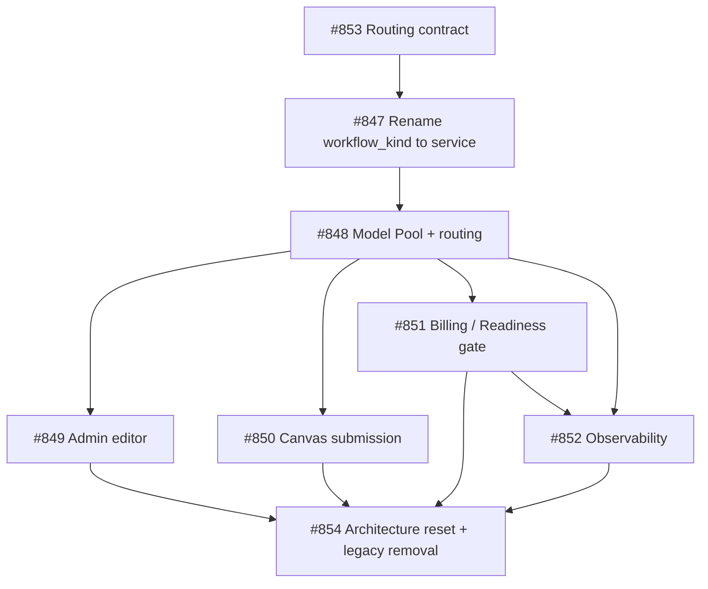

# IdeaBoard Model Pool Feature — Agent Execution Guide

## Purpose

This guide coordinates implementation of the Service Model Pool feature and the Generation Pipeline Architecture Reset tracked by GitHub Issues **#847–#854** in `Ericsunsk/IdeaBoard`.

The stable design contract lives in [ADR-0012](../adr/0012-service-model-pool-routing-contract.md).
This guide is the execution companion: it records issue order, repository boundaries,
verification gates, and rollout constraints. When implementation detail conflicts with the
ADR, the ADR wins and the guide must be updated before work continues.

The target behavior is:

```text
Service
  └── enabled Model pool
        ├── Model A  [1K] [2K] [4K]
        ├── Model B        [2K] [4K]
        └── Model C  [1K]             (disabled)
```

When a user requests a Service at a resolution, the runtime selects an enabled Model that supports that resolution, balances traffic across eligible Models, and retries one remaining candidate for retryable upstream failures.

Model identity is an Admin and observability concern. It is not exposed as a normal user choice.

## Architecture reset scope

This feature is also the migration boundary for the image-generation pipeline. Do not
implement the Model Pool as an array replacement for the existing single-Model lookup.
The target is one Service-centered generation architecture with one routing contract from
request intake through provider execution.

The refactor is deliberately broad across the generation domain, but it is not a reason to
rewrite unrelated infrastructure, authentication, queues, or frontend frameworks. Keep the
existing PostgreSQL, `pgx`, `sqlc`, River, gateway, error, OpenAPI, Vue Query, and Valibot
primitives unless a concrete contract gap is demonstrated.

### Canonical domain objects

The implementation should converge on these objects:

```text
Service
  └── ModelPoolEntry
        ├── model
        ├── enabled
        └── supported_resolutions

GenerationRequest
  ├── service
  ├── resolution
  ├── size
  └── prompt

RoutingSnapshot
  ├── service
  ├── requested_resolution
  ├── eligible_models
  ├── selected_model
  ├── retry_candidate
  ├── selection_seed
  └── pool_version

GenerationTask
  ├── request
  ├── routing_snapshot
  ├── billing_snapshot
  └── execution_attempts

ExecutionAttempt
  ├── task_id, attempt_no, execution_token, river_job_id
  ├── service, requested_model, resolved_model, provider
  ├── retry_layer, gateway_retry_count, status
  └── failure_stage, failure_category, started_at, completed_at
```

The user-facing request expresses `Service + resolution + size + prompt`. Model identity
is selected internally, pinned in the immutable `RoutingSnapshot`, and consumed by the
Worker. A Worker must not re-read the mutable live Model Pool for an accepted task.
`ExecutionAttempt` is a durable PostgreSQL fact and must not contain prompts, provider
payloads, credentials, or storage URLs. Its `retry_layer` is exactly `gateway`,
`model_fallback`, or `river_task`.

### Context boundaries

Keep these responsibilities explicit:

1. **Catalog/configuration** owns Services, Models, capabilities, pool entries, and pool versions.
2. **Routing** owns eligibility, deterministic balanced selection, and the immutable snapshot.
3. **Quote/billing** owns `Service + resolution + quantity`; Model selection does not change price.
4. **Task lifecycle** owns the transactional task, billing hold, River enqueue, and execution attempts.
5. **Provider execution** translates canonical resolution and executes the pinned Model through the gateway.
6. **Observability** records routing and attempt facts without changing task or billing semantics.

`RoutingResolver` is the only authoritative routing seam. Readiness, quote, submit, and
Worker execution must consume its contract rather than implement independent Model lookups.

### Frozen routing decisions

The following details are fixed for implementation and must not be reopened in #847–#854:

- Sort eligible canonical Model references lexicographically, generate a persisted 128-bit
  cryptographically random `selection_seed` at submit, and select
  `SHA-256(selection_seed || U64BE(pool_version) || 0x00 || UTF8(service) ||
  0x00 || UTF8(resolution)) % candidate_count`.
  The next sorted candidate is the only `retry_candidate`.
- `pool_version` is a per-Service monotonically increasing `uint64` starting at `1`; it
  increments only when an effective pool entry, enabled state, or capability set changes.
- Persist the immutable, versioned `RoutingSnapshot` as JSONB on the task row in the submit
  transaction. Workers never reconstruct it from the live pool.
- `service_resolution_unavailable` is HTTP `422` with normalized values at
  `details.fields.service` and `details.fields.resolution`.
- Vision search stays outside Service Model Pool routing until a separate ADR changes that
  boundary.

### Clean-break migration rules

Use one coordinated schema/API migration boundary:

1. Introduce the Service, Model Pool, capability, pool-version, and routing-snapshot structures.
2. Move every read and write path to the new contract.
3. Remove `workflow_kind`, single-value `feature -> model` settings, `ResolveModel(feature)`,
   live pool lookup from Workers, and obsolete compatibility DTOs.
4. Regenerate `sqlc`, OpenAPI, and frontend clients from the new source contracts.
5. Delete compatibility aliases, dual-read paths, dual-write paths, and fallback shims.

The migration may be delivered in reviewable implementation phases, but runtime behavior must
have one target semantic. Do not keep old and new routing systems active in parallel.

### Execution phases

Implement the architecture reset in these phases while preserving the issue dependency graph:

1. **Contract freeze**: finalize Service, resolution, pool, snapshot, error, and retry contracts in #853.
2. **Persistence and catalog**: add normalized pool/capability data, versioning, and atomic Admin saves in #848/#849.
3. **Routing and submission**: implement the resolver and pin the snapshot in the transactional submit path.
4. **Execution**: make the Worker consume only the snapshot; record attempts and perform one bounded Model fallback.
5. **Billing and user flow**: align quote, readiness, Canvas submission, and unavailable errors in #850/#851.
6. **Observability**: expose selected/attempted Models, pool version, and failure class in #852.
7. **Removal and verification**: #854 deletes old paths, regenerates artifacts, rehearses migrations, and runs the full gates.

### Retry and failure boundaries

Keep these as separate mechanisms with separate counters and facts:

```text
Gateway request retry  -> same Model, bounded HTTP retry policy
Model fallback         -> next pinned eligible Model, at most once
River/task retry       -> task-level requeue according to task policy
```

Deterministic business failures must not trigger Model fallback. A fallback must not create a
second charge or duplicate task. Empty candidates must converge to `service_resolution_unavailable`
before task creation or billing.

### Architecture reset verification

Before closing the migration, verify all of the following:

- No production caller independently resolves a live Model for an accepted task.
- Quote, readiness, submit, and Worker execution use the same Service/resolution semantics.
- The snapshot is sufficient to replay and diagnose selection and fallback decisions.
- Pool edits are atomic and versioned; accepted tasks remain stable after later edits.
- Retry layers are distinguishable in logs, metrics, task facts, and Admin views.
- Repository searches find no active `workflow_kind`, single-value Model mapping, or compatibility shim.
- Migration rehearsal, generated-code checks, targeted tests, builds, and lint gates pass.

### Observability architecture

OpenTelemetry is adopted as a tracing and context-propagation engine for the Generation
Pipeline. It does not replace Prometheus metrics, River/PostgreSQL task facts, or NATS event
transport, and it does not serve Vue directly.

Use this boundary:

```text
Go API / Worker
  -> OpenTelemetry SDK
  -> OTLP
  -> OpenTelemetry Collector
  -> Trace backend (Tempo, Jaeger, or the selected equivalent)

Vue Admin
  -> authenticated Go Admin Observability API
  -> PostgreSQL facts + Prometheus queries + trace-backend queries
  -> stable, redacted frontend DTOs
```

The Admin API is the only frontend-facing observability seam. It owns authorization,
time-range limits, aggregation, redaction, and DTO stability. Vue must not query a Collector,
trace backend, or Prometheus directly.

Use PostgreSQL for `RoutingSnapshot`, `ExecutionAttempt`, task, and billing facts; Prometheus
for operational metrics and alerting; traces for cross-process timing and causality. Do not
write spans into the business database or make telemetry export a readiness dependency.

Initial trace coverage is limited to HTTP submit, `RoutingResolver`, the transactional submit
boundary, River-to-Worker handoff, execution attempts, Gateway requests, Model fallback, and
terminal settlement. Propagate W3C Trace Context across the asynchronous boundary using minimal
queue metadata and a linked Worker span; do not put trace metadata in billing facts or expose it
as a user contract.

Trace attributes are allowlisted and low-cardinality (`service`, `resolution`, `pool_version`,
`selected_model`, `attempt_number`, `retry_layer`, `failure_class`, and queue name). Never export
prompt text, image or storage URLs, user identifiers, provider payloads, SQL parameters, or
credentials. Collector/exporter failure must not fail Quote, Submit, Billing, River enqueue,
Worker execution, or terminal convergence.

The initial Go dependency set is limited to the official OTel API/SDK, trace API, OTLP trace
HTTP exporter, and `otelhttp` instrumentation. Keep versions explicitly pinned in
`apps/api/go.mod`; OTel modules present only through `sqlc` or gRPC transitive dependencies do
not count as application integration. Add a Collector and trace backend to deployment only after
the backend, retention, TLS, resource, and redaction policy is selected. Collector availability
is never an API readiness gate.

## Source of truth

Work from the following issues in dependency order:

1. **#853 — Define Service Model Pool routing contract**
2. **#847 — Breaking rename: `workflow_kind` to `service`** (blocked by #853)
3. **#848 — Add Service Model Pool and resolution-aware routing** (blocked by #847 and #853)
4. **#849 — Admin Model Pool editor for Service pricing** (blocked by #848)
5. **#850 — Route Canvas submissions through Service Model Pools** (blocked by #847 and #848)
6. **#851 — Enforce Model Pool availability in Billing and Readiness** (blocked by #848; can run in parallel with #850)
7. **#852 — Add Service Model Pool routing observability** (blocked by #848 and #851)
8. **#854 — Complete Generation Pipeline architecture reset and legacy removal** (blocked by #847–#852)

GitHub blocking relationships are already configured. Do not start a blocked issue before its blockers are complete, unless the team explicitly agrees to an integration branch.

Issue #854 is the final cross-cutting integration and removal gate. It must not duplicate the
implementation work in #847–#852; it verifies that all paths converge on the new contract,
that the migration has been rehearsed, and that legacy routing paths are deleted.

## Product decisions already settled

- `Service` is the product capability formerly represented by workflow features such as `generation`, `inpaint`, `render`, and `variations`.
- The clean break is intentional. Rename `workflow_kind` to `service` across the system; do not retain a compatibility alias.
- A Service owns a Model pool. A Model may be reused by multiple Services.
- A Model pool entry has only:
  - Model reference
  - enabled state
  - supported resolutions (`1K`, `2K`, and/or `4K`)
- Do not add Admin-configurable `priority`, `fallback`, or `weight` fields.
- For a requested resolution, only enabled pool entries supporting that resolution are eligible.
- Eligible Models are selected with uniform load balancing.
- After a retryable upstream failure, retry one remaining eligible candidate. Do not retry deterministic business errors such as invalid parameters, insufficient credits, or content-safety rejection.
- If there are no eligible Models, return `422 service_resolution_unavailable` before task creation or billing.
- Billing remains keyed by `Service + resolution + quantity`; switching Models does not change price.
- Fixed-resolution Services may continue to use the `default` billing variant.
- The frontend continues to show resolutions already launched in the product. It does not dynamically hide `1K`, `2K`, or `4K` merely because the current pool is empty. Runtime unavailability is a backend error surfaced as a toast.
- Provider-specific resolution parameters belong in the gateway/runtime adapter. Admins configure canonical resolutions, not provider JSON.
- A submit-time routing snapshot pins the eligible pool entries, requested Service and resolution, selection seed, and pool version. Later pool edits do not invalidate an accepted task or change its retry candidate set.
- The user flow does not fetch or depend on a dynamic `available_resolutions` list. Launched resolution options remain visible; an empty runtime pool produces `service_resolution_unavailable`.
- `RoutingResolver` is the only authoritative Model Pool decision seam. Readiness, quote, submit, and worker execution must not each perform their own live Model lookup.
- `params.output_resolution` is the client resolution source of truth. Any internal or top-level billing resolution is derived from the normalized execution plan or checked for exact agreement.
- The old single-value `feature -> model` settings mapping is removed from the active path. No compatibility adapter or dual-field request shape remains.

## Non-negotiable repository rules

- Read the repository `AGENTS.md`, relevant `CONTEXT.md`, `DESIGN.md`, `apps/web/DESIGN.md`, and `DEVELOPMENT.md` before editing.
- Keep changes within the current checkout and branch. Do not create worktrees or switch branches.
- Do not hand-edit generated frontend API wrappers under `apps/web/src/shared/api/generated-query`.
- Do not hand-edit generated sqlc files under `apps/api/internal/db/sqlc`.
- Update schema fragments/migrations, then regenerate generated artifacts using the repository commands.
- Admin route pages must use feature/resource/adapter boundaries and must not call generated API clients directly.
- Preserve transactional task submission: task insertion, billing hold, and River enqueue remain atomic.
- River + PostgreSQL remain the task/state fact source. NATS JetStream remains the event layer.
- Do not mix this feature with unrelated dirty work already present in the checkout.
- Never include credentials, provider tokens, customer data, or storage URLs in code, tests, logs, or tickets.

## Execution order

### 1. Issue #853 — Define the routing contract

This ticket is the shared design gate. Record the contract in an ADR or equivalent canonical design document before implementing the rename or pool.

The contract must define:

- Service -> pool entry -> Model shape
- canonical `1k`, `2k`, and `4k` resolutions, plus fixed `default` semantics
- eligibility and disabled-entry rules
- balanced selection and one-candidate retry classification
- `service_resolution_unavailable` response shape
- the submit-time routing snapshot and pool version
- the single `RoutingResolver` seam consumed by readiness, quote, submit, and worker layers
- the separation between gateway request retries, Model fallback, and River/task retries
- the one-time resolution canonicalization rule
- the rule that frontend-launched resolutions stay visible

No implementation ticket should invent a competing version of these rules.

### 2. Issue #847 — Rename `workflow_kind` to `service`

This is a repository-wide mechanical change and must land first.

Scope:

- HTTP request and response contracts
- Go domain types and validation
- TypeScript domain and transport types
- Task submission, quote, and readiness paths
- Durable execution JSON and persistence fields
- Database migration and schema artifacts
- OpenAPI fragments and generated frontend clients
- Admin labels, monitoring labels, and tests

Requirements:

- Reject requests that only contain the old field with a documented 4xx response.
- Update durable schema validation and fixtures together with the field rename.
- Re-run code generation; never patch generated output manually.
- Search the repository for remaining runtime uses of `workflow_kind` before closing the issue. Historical documentation may mention the old name only when explaining the migration.
- Search for remaining production uses of `ResolveModel(feature)`, single-value mapping keys, dual `feature`/`service` request fields, and independently authoritative resolution fields.

Verification:

```bash
cd apps/api && go test ./...
cd apps/api && go build ./...
cd apps/web && npm run test:run
cd apps/web && npm run build
```

### 3. Issue #848 — Model Pool and resolution-aware routing

Implement the backend source of truth for pool configuration and runtime selection.

Recommended domain shape:

```text
service_model_pool_entry
- id
- service
- model_id
- enabled
- created_at
- updated_at

service_model_pool_resolution
- pool_entry_id
- resolution
```

Use uniqueness constraints equivalent to:

```text
unique(service, model_id)
unique(pool_entry_id, resolution)
```

Accepted tasks must also persist a routing snapshot containing the eligible pool entries, requested Service and resolution, selection seed, and pool version used by the submit transaction. Worker retry must use this snapshot rather than re-reading a mutable pool.

The exact table names may follow existing repository conventions, but the invariants must remain.

Required behavior:

- One Model can be reused across Services.
- One pool entry can support multiple canonical resolutions.
- Disabled entries are excluded.
- Candidate selection is balanced without an Admin priority field.
- Retry is bounded to one remaining candidate for retryable upstream failures.
- A failed candidate must not cause a second charge or duplicate task.
- Empty candidate sets converge to `service_resolution_unavailable`.
- Fixed-resolution workflows retain their existing validation semantics.
- Later Admin edits cannot invalidate an accepted task or change its retry candidates.
- No worker path re-resolves the current Admin Model Pool for an accepted task.
- Model fallback advances the persisted candidate state atomically and remains distinct from gateway and River retries.

Keep routing deterministic enough for tests and diagnosis. A task-scoped hash or equivalent stable selection strategy is preferred over opaque randomness.

Add unit and integration coverage for:

- resolution filtering
- disabled entries
- balanced selection
- no-candidate errors
- retryable versus deterministic failures
- idempotency and billing safety

### 4. Issue #849 — Admin Model Pool editor

Extend the existing credits pricing/Admin model boundaries. Do not create a second model catalog.

Target UI:

```text
Service | Status | 1K Price | 2K Price | 4K Price | Model Pool | Actions
```

The Model Pool summary should be compact, for example:

```text
Model A  [1K] [2K] [4K]
Model B        [2K] [4K]
```

The editor must support:

- add a Model from the existing catalog
- remove a Model from the Service pool
- toggle enabled
- toggle `1K`, `2K`, and `4K` badges
- save with the existing operator-reason confirmation flow
- replace the complete Service pool atomically in one mutation

Validation:

- An enabled Model must support at least one resolution.
- A Service cannot be considered available with zero enabled Models.
- Pool saves must use optimistic concurrency or the repository's equivalent version check.
- Pool saves preserve a monotonically identifiable pool version for routing snapshots.
- Do not expose priority, fallback, or weight controls.
- Preserve loading, stale, retry, mutation error, and accessibility states used by existing Admin components.

Keep generated API access behind the Admin resource adapter. Add component/resource tests for load, edit, save, validation, and failed mutation paths.

### 5. Issue #850 — Canvas submission

Update Canvas to submit `service` while preserving the existing image-generation payload semantics.

Canonical request concept:

```json
{
  "service": "generation",
  "inputs": {
    "media_asset_ids": ["asset_..."]
  },
  "prompt": "a red house",
  "params": {
    "ratio": "1:1",
    "custom_width": 1024,
    "custom_height": 1024,
    "output_count": 1,
    "output_resolution": "2k"
  }
}
```

Rules:

- Keep workspace media references in `inputs.media_asset_ids`.
- Keep `params.output_resolution` as the canonical client resolution.
- Keep prompt, ratio, custom dimensions, and output count semantics unchanged.
- Do not dynamically hide a launched resolution based on current pool configuration.
- Do not add a dynamic `available_resolutions` dependency to the user flow.
- Canonicalize resolution once at ingress; do not allow `params.output_resolution` and an internal/top-level billing resolution to disagree.
- Map `service_resolution_unavailable` to a clear user toast.
- The unavailable path must not create a task or billing hold.

Add focused contract tests for request construction, error mapping, and the no-task/no-charge path.

### 6. Issue #851 — Billing and readiness availability gate

Make quote, readiness, and submit consult the same Service Model Pool availability decision.

Rules:

- Prices remain independent per Service and resolution.
- Model changes do not change price.
- Availability must be checked before Credit Hold and task creation.
- Quote, readiness, and submit must converge on the same error code and semantics.
- Fixed-resolution Services continue to use `default` where appropriate.
- Billing snapshots must retain the requested Service and resolution.
- Availability uses the shared routing contract; it does not introduce a second frontend availability source.
- Submit persists the routing snapshot atomically with the billing/task/enqueue transaction.

Add tests proving that an unavailable resolution cannot reserve credits, create a task, or enqueue work.

### 7. Issue #852 — Routing observability

Expose routing decisions to Admin monitoring and task details without leaking Model implementation details to ordinary users.

Record at minimum:

- requested Service
- requested resolution
- submit-time routing snapshot and pool version
- selected/final resolved Model
- attempted candidates when retry occurs
- retryable failure reasons

Ensure statistics can attribute execution to the final resolved Model. Do not alter task state transitions, billing snapshots, or user-facing task result semantics.

Distinguish gateway request retries, Model fallback attempts, and River/task retries in the stored facts and Admin presentation.

Add monitor/detail tests for successful routing, retry, final failure, and missing model data.

### 8. Issue #854 — Complete the Generation Pipeline architecture reset

This is the final integration ticket after #847–#852. It is responsible for closing the
cross-module gaps that cannot be owned by one feature ticket and for deleting the old runtime
semantics.

Verify the complete path:

```text
Service Catalog
  -> canonical request normalization
  -> RoutingResolver
  -> immutable RoutingSnapshot
  -> transactional billing/task/River submit
  -> snapshot-based Worker execution
  -> bounded Model fallback
  -> provider gateway retries
  -> durable ExecutionAttempt facts
```

Required outcomes:

- Task intake, settlement, runtime orchestration, Worker execution, gateway mapping, billing,
  readiness, and Admin monitoring share the Service/resolution contract.
- Durable ExecutionAttempt facts distinguish gateway retries, Model fallback, and River/task retries.
- No accepted task reads a mutable live Model Pool.
- `workflow_kind`, single-value Model settings, `ResolveModel(feature)`, compatibility aliases,
  dual-read/write paths, and fallback shims are removed from production code.
- Schema migration and generated artifacts are rehearsed; architectural searches and end-to-end
  failure tests pass.

Do not introduce a second routing, retry, transaction, ORM, or orchestration framework. Reuse
the repository primitives listed in the Architecture reset scope.

## API and error contract

Use one canonical error for an empty eligible pool:

```text
HTTP 422
code: service_resolution_unavailable
```

The error must identify normalized values as `details.fields.service` and
`details.fields.resolution`. Do not expose provider credentials, raw upstream
payloads, or storage internals.

Provider/model resolution mapping belongs below the canonical Service contract. The client and Admin UI should not need to know provider-specific parameter names.

## Dependency graph



After #848, #849, #850, and #851 can be planned as separate workstreams; #850 does not block #851.

## Required routing shape

The implementation should converge on this flow:

```text
Ingress
  -> normalize service + resolution
  -> RoutingResolver.resolve(service, resolution)
  -> validate/quote/readiness
  -> authoritative Submit transaction:
       resolve + pin RoutingSnapshot
       -> Credit Hold
       -> Task insert
       -> River enqueue
  -> Worker consumes the pinned snapshot
       -> selected Model
       -> one bounded Model fallback if retryable
       -> gateway request retries remain inside gateway
```

Do not replace the current single Model string with an array while leaving the existing lookup sites in place. That would preserve the inconsistency the Model Pool is intended to remove.

## Testing and verification gates

Run the smallest relevant checks while iterating, then the full gates before closing each issue:

```bash
# Frontend
cd apps/web && npm run test:run
cd apps/web && npm run build
cd apps/web && npm run lint
cd apps/web && npm run lint:style

# Backend
cd apps/api && go test ./...
cd apps/api && go build ./...

# Schema/query changes
cd apps/api && go tool sqlc generate
cd apps/api && go run ./cmd/schemarelease --write-artifact
```

Only run commands applicable to the changed area, but document any skipped gate and residual risk in the issue.

## Definition of done

A ticket is ready to close only when:

- Its end-to-end acceptance criteria pass.
- Relevant unit, contract, integration, type, build, and lint checks pass.
- Generated artifacts are up to date.
- No unrelated files or pre-existing dirty changes were modified.
- The issue contains a concise verification report and any residual risk.
- The next unblocked issue can start from a clean, understandable contract.

## Coordination protocol for agents

Before editing:

1. Read the issue and its blockers.
2. Inspect the current branch and preserve unrelated changes.
3. Identify the owning context and adapter boundary.
4. Write a short implementation plan for multi-file or schema work.

During editing:

1. Prefer small, reversible patches.
2. Keep domain contracts and generated artifacts synchronized.
3. Add meaningful tests for new behavior and failure modes.
4. Do not silently broaden scope.

Before reporting completion:

1. Run the relevant verification commands.
2. Review `git diff` and `git status`.
3. Report files changed, checks run, and unresolved risks.
4. Close or update only the assigned issue; do not modify parent or unrelated issues.
