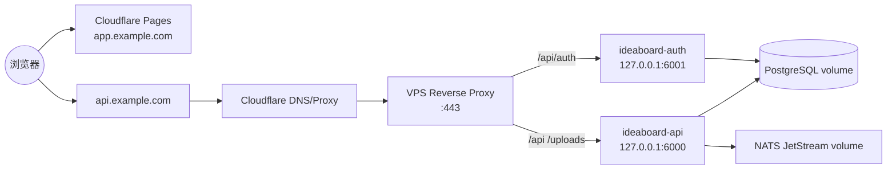

# <div align="center">IdeaBoard 部署手册</div>

<p align="center">
  <strong>Cloudflare Pages + VPS Docker Compose 的部署、升级与回滚手册。</strong>
</p>

<p align="center">
  目标运行形态：<code>Cloudflare Pages + Cloudflare DNS/Proxy + VPS Reverse Proxy + GHCR + Docker Compose</code>
</p>

<p align="center">
  <code>私有</code>
  <code>闭源</code>
  <code>内部运维文档</code>
</p>

<p align="center">
  <a href="#deployment-profile">部署概览</a> ·
  <a href="#recommended-docker">Docker 部署</a> ·
  <a href="#cloudflare-edge-hardening">Cloudflare 加固</a> ·
  <a href="#operations">日常运维</a> ·
  <a href="#upgrade-and-rollback">升级回滚</a>
</p>

> [!IMPORTANT]
> 本文档仅供 IdeaBoard 授权成员在内部部署与运维场景下使用。项目为闭源私有项目，未经授权不得复制、分发或对外传播。
>
> 账号安全与业务运维的职责边界请同时参考 [auth-operations.md](./auth-operations.md)；PostgreSQL backup / restore 的密钥材料处理规则见 [data-protection.md](./data-protection.md)。

<a id="deployment-profile"></a>
## 部署概览

本文档覆盖当前推荐生产路径：`Cloudflare Pages + Cloudflare DNS/Proxy + VPS Reverse Proxy + GHCR + Docker Compose`。



生产职责边界：

- Cloudflare Pages 托管 `apps/web/dist`。
- Cloudflare DNS/Proxy 暴露 `api.example.com` 并提供 WAF / Rate Limiting / Cache Rules。
- VPS 宿主机 Nginx 只反代 `/api/*`、`/api/auth/*`、`/uploads/*` 到 Docker Compose 中的 API/Auth。
- Docker Compose 管理 API、Auth、PostgreSQL、NATS JetStream 与 `api-uploads` volume。
- River 任务队列写入 PostgreSQL；JetStream 只承载状态事件、audit 与实时 fanout。

任务 retry 分两层：`taskruntime` 的 `defaultTaskRetryLimit=3` 是 DB/provider failover 的业务 retry 上限；River `MaxAttempts` 是 worker panic、process error、临时基础设施故障的队列层 retry。River 运行参数与 NATS retention 在 Admin System Settings 中管理，修改后页面会标记需要重启 API；River `MaxAttempts` 必须大于等于业务 retry 上限，避免队列层过早进入 final failure convergence。Egress allowlist 按请求读取，保存后动态生效。

Pages 项目建议配置：

| 项目 | 值 |
|------|----|
| Root directory | `apps/web` |
| Build command | `npm run build` |
| Build output directory | `dist` |
| Environment variable | `NODE_VERSION=22.22.2` |
| Environment variable | `VITE_API_BASE_URL=https://api.example.com/api` |
| Auth public origin | Derived from `VITE_API_BASE_URL` by removing the trailing `/api` |

VPS 侧至少同步：

```bash
# /opt/stacks/ideaboard/docker/.env
APP_BASE_URL=https://app.example.com
API_BASE_URL=https://api.example.com
```

Cloudflare DNS 配置：

```text
Type: A 或 AAAA
Name: api
Value: VPS 公网 IP
Proxy status: Proxied
```

VPS 防火墙只开放 SSH、80、443。API/Auth 容器只绑定 `127.0.0.1:6000`、`127.0.0.1:6001` 和仅供监控使用的 `127.0.0.1:9091`，不要把 `6000/6001/9091/PostgreSQL/NATS` 暴露到公网。

<a id="cloudflare-edge-hardening"></a>
## Cloudflare 加固

生产 API 域名默认使用 `Proxied`；临时切到 `DNS only` 时，Cloudflare WAF、Rate Limiting、Cache Rules 和源站 allowlist 均不再生效，上线前必须切回并复验。

- Origin 防火墙：VPS 安全组 / `ufw` 只开放 SSH、80、443；80/443 入站只允许 Cloudflare IP ranges 到达源站，或使用等价的源站防火墙策略。
- 真实客户端 IP：宿主机反代层只信任 Cloudflare 来源，并通过 `CF-Connecting-IP` 恢复真实客户端 IP，再向 API/Auth 传递 `X-Real-IP`、`X-Forwarded-For`、`X-Forwarded-Proto`。
- Cache Rules：对 `/api/*`、`/api/auth/*`、SSE 任务状态接口、上传写入接口，以及所有带 `Authorization` 或 session Cookie 的请求设置 bypass cache。`/uploads/*` 可单独按素材访问策略缓存。
- Metrics：API 使用独立 Prometheus listener；compose 默认仅将 `9091` 绑定到宿主机 `127.0.0.1`。监控系统抓取 `/metrics`，Nginx/Cloudflare 不得代理该端口或路径。
- Rate Limiting / WAF：至少覆盖 `/api/auth/*`、管理员接口、上传接口、任务提交接口。对 `POST /api/user/rewards/redeem` 按可信客户端 IP 设置初始 `60 attempts / 10 minutes` coarse limit；Cloudflare 使用 `CF-Connecting-IP`，源站反代仅在请求确由 Cloudflare allowlist 到达时信任该值。该 edge rule 与应用内 per-user `10 attempts / 10 minutes` limiter 共同生效。首次启用建议先用 log / challenge / captcha 灰度观察误伤，再切换到 block。
- Pages 环境隔离：production 与 preview 使用独立 `VITE_API_BASE_URL`、`VITE_PUBLIC_ASSET_BASE_URL`；preview 不连接生产 API/Auth/数据库。
- HTTPS / HSTS：SSL/TLS 使用 `Full (strict)`；Always Use HTTPS 和 HSTS 先灰度，不要一开始启用 `preload` 或 `includeSubDomains`。

<a id="recommended-docker"></a>
## Docker 部署

推荐方式是 CI 构建镜像并推送到 GHCR，VPS 只拉取镜像和启动容器：

```text
GitHub Actions
  -> ghcr.io/<owner>/<repo>/ideaboard-api@sha256:<digest>
  -> ghcr.io/<owner>/<repo>/ideaboard-auth@sha256:<digest>
  -> ghcr.io/<owner>/<repo>/ideaboard-auth-migrate@sha256:<digest>

VPS
  -> ideaboard update --manifest release-manifest.json
```

### 1. 构建并发布镜像

仓库已内置 [docker-images.yml](../../.github/workflows/docker-images.yml)。触发方式：

- push 到 `main` / `master`
- push `v*` tag
- 在 GitHub Actions 手动运行 workflow，并可填写额外 `image_tag`

生产部署不要把 VPS 端 bootstrap 绑定到 `main`；请始终使用明确的发布 tag 或 commit SHA。镜像部署值必须使用 GitHub Actions 输出的 digest 引用。

Docker Images workflow 会在发布镜像后上传 `release-manifest` artifact，tag 发布还会把 `release-manifest.json` 附到同一 GitHub Release。该 manifest 是推荐升级输入，记录本次 workflow 的 `tag` / `ref` / `commit` / `run_id`、三张 GHCR digest 镜像引用、SBOM artifact 名称与 Cosign OIDC identity。

发布路径会为每个镜像生成 CycloneDX SBOM artifact，使用 Grype 拦截 `high` 及以上漏洞，并用 Cosign keyless OIDC 对镜像 digest 签名。Grype 例外统一维护在 [`.grype.yaml`](../../.grype.yaml)，新增例外时只加窄范围规则并记录原因与复查日期。

`ideaboard update` 默认会在 pull 前执行 Cosign keyless 验签。VPS 必须先安装 `cosign`；离线排障时才临时设置 `COSIGN_VERIFY=false`。手动验签示例：

```bash
cosign verify \
  --certificate-identity "https://github.com/<github-owner>/<github-repo>/.github/workflows/docker-images.yml@refs/heads/main" \
  --certificate-oidc-issuer "https://token.actions.githubusercontent.com" \
  "ghcr.io/<github-owner>/<github-repo>/ideaboard-api@sha256:<digest>"
```

### 2. 首次 VPS 初始化

快捷初始化：

```bash
export GITHUB_TOKEN="your-github-token" && curl -fsSL -H "Authorization: token ${GITHUB_TOKEN}" -H "Accept: application/vnd.github.raw" "https://api.github.com/repos/Ericsunsk/IdeaBoard/contents/scripts/bootstrap-vps.sh" -o /tmp/bootstrap-vps.sh && bash /tmp/bootstrap-vps.sh
```

部署特定版本：

```bash
TOKEN="your-github-token"
REF="v0.1.0" # 改为目标 tag 或 commit SHA
curl -fsSL \
  -H "Authorization: token ${TOKEN}" \
  -H "Accept: application/vnd.github.raw" \
  "https://api.github.com/repos/Ericsunsk/IdeaBoard/contents/scripts/bootstrap-vps.sh?ref=${REF}" \
  -o /tmp/bootstrap-vps.sh
GITHUB_TOKEN="${TOKEN}" bash /tmp/bootstrap-vps.sh --ref "${REF}"
```

把 `REF` 换成明确的发布 tag 或 commit SHA。强制重装可加 `IDEABOARD_FORCE=1`；脚本会备份旧目录并恢复 `docker/.env`。Bootstrap 会在部署前检查 `cosign`，除非你已经在 `docker/.env` 里显式设置 `COSIGN_VERIFY=false`。

至少修改 `/opt/stacks/ideaboard/docker/.env`：

- `APP_BASE_URL`
- `API_BASE_URL`
- `IDEABOARD_API_IMAGE`
- `IDEABOARD_AUTH_IMAGE`
- `IDEABOARD_AUTH_MIGRATE_IMAGE`
- `POSTGRES_PASSWORD`
- `API_DB_PASSWORD`
- `AUTH_DB_PASSWORD`
- `AUTH_INTERNAL_KEY`
- `APP_SECRETS_ENCRYPTION_KEY`
- `BETTER_AUTH_SECRET`
- `NATS_PASSWORD`

### 3. 后续部署 / 升级

优先使用同一发布批次的 manifest：

```bash
ideaboard update --manifest release-manifest.json
```

没有 manifest 时可使用 fallback：

```bash
ideaboard update
```

`ideaboard update` 会执行：

1. 自动拉取部署目录中的配置、脚本和数据库迁移文件。
2. 写入三张镜像 digest；manifest 优先，自动解析 tag/latest 作为 fallback。
3. 创建 `.env` snapshot 与 `docker/releases/history/*.json` 发布记录。
4. 执行 preflight、Cosign 验签、pull、backup、migration、重启与 smoke gate。
5. 成功后写入 `docker/releases/current.json`，并把上一版保存为 `docker/releases/previous.json`。

Migration 前失败会恢复 `.env` snapshot；migration 后失败不会自动 restore DB，但会输出 release id、失败阶段、backup 路径和 previous digest。

### 4. Backup Hardening

> [!IMPORTANT]
> PostgreSQL backup 包含 `api_account_secrets`、`storage_profile_secrets` 等密钥表，可能含有上游 API key、S3 access key/secret、endpoint 与 bucket 配置。`postgres-*.dump[.age|.gpg]` 必须按 secret artifact 处理。

- 每个 PostgreSQL 与 uploads backup 会生成同名 `.sha256` 文件，例如 `postgres-ideaboard-YYYYMMDD-HHMMSS.dump.sha256`、`postgres-ideaboard-YYYYMMDD-HHMMSS.dump.age.sha256`、`api-uploads-YYYYMMDD-HHMMSS.tar.gz.sha256`。
- 设置 `BACKUP_ENCRYPTION_RECIPIENT` 后，backup 会先加密再为最终落盘 artifact 生成 checksum。`age1...`、`ssh-*` 或 `age:<recipient>` 使用 age；`gpg:<recipient>` 或其他值按 GPG recipient 处理。
- `ideaboard doctor` 会展示最近 backup 的路径、`checksum=valid|invalid|missing|unchecked`、是否加密，以及最近 release 记录中的 backup 阶段状态。
- 当前 DB restore 仍需人工确认；脚本不会在 migration 后失败时自动回滚数据库。

当前 Docker stack 只管理 PostgreSQL 数据库。首次部署或切换部署形态前，请先确认目标 PostgreSQL 中已有需要保留的数据，或明确按空库初始化。

<a id="api-database-baseline"></a>

### 5. API 业务库 baseline

`ideaboard` 是固定 schema owner；`ideaboard_api` 与 `ideaboard_auth` 是彼此独立的 limited runtime roles。三个 roles 必须使用不同密码；长期运行的 API/Auth 容器只接收各自 runtime credential，只有一次性的 `api-migrate` / `auth-migrate` 容器接收 owner credential。

空 PostgreSQL 库由 API migration 初始化业务 schema 并写入当前 migration 版本；API runtime 不再自动迁移。Docker 部署会先运行 `api-migrate`，授予 runtime 常规业务表 DML，并将 Credits Ledger 收紧为只读 + typed Credit Commands；再运行 Auth migration，为 Auth runtime role 授予 Better Auth tables DML 与 `get_auth_runtime_settings()` 的 `EXECUTE`，最后启动服务。

非空数据库不能直接套用该 baseline。若你从其他形态迁入数据，标准做法是先导出需要保留的数据，再在空库上初始化当前 baseline，最后用受控脚本导入业务数据；不要手动修改 `schema_migrations` 绕过 baseline 校验。

当前 API migration 保护会拒绝三类风险状态：未知历史 migration 版本；baseline 未应用但 schema 已有 API-owned 业务表；baseline 已标记应用但当前 schema 缺少 baseline 业务表。Better Auth 的认证表可以先存在，不计入 API baseline 冲突；不过标准部署顺序仍是 API baseline first、Better Auth migration second。

PostgreSQL init script 只在空 volume 创建 API/Auth runtime roles。项目尚未上线时若本地 volume 早于该角色分离方案，直接删除并重建开发 volume；不要把 owner credential 配回任何长期运行的应用 runtime。

### 6. 初始化管理员

```bash
docker compose -f /opt/stacks/ideaboard/docker/compose.yml --env-file /opt/stacks/ideaboard/docker/.env run --rm \
  -e INIT_ADMIN_PASSWORD='your-strong-password' \
  api init-admin
```

### 7. VPS 反代

生成 Nginx 配置：

```bash
ideaboard nginx-conf /tmp/ideaboard.nginx.conf
sudo cp /tmp/ideaboard.nginx.conf /etc/nginx/sites-available/ideaboard.conf
sudo ln -sf /etc/nginx/sites-available/ideaboard.conf /etc/nginx/sites-enabled/ideaboard.conf
sudo nginx -t
sudo systemctl reload nginx
```

如果 VPS 已经有 certbot 或自管的 `443 ssl` server block，可以把生成文件里的 `/api`、`/api/auth`、`/uploads` location 合并进现有 API 域名 server block。

默认 upstream 是宿主机 loopback 端口：

```text
NGINX_API_UPSTREAM=http://127.0.0.1:6000
NGINX_AUTH_UPSTREAM=http://127.0.0.1:6001
NGINX_AUTH_HEALTH_UPSTREAM=http://127.0.0.1:6001/api/health
```

如需明确绑定 API 域名，可设置 `NGINX_SERVER_NAME=api.example.com` 后重新执行 `ideaboard nginx-conf`。

如果 API 域名使用 Cloudflare `Proxied`，并且 VPS 防火墙已限制 80/443 只接受 Cloudflare IP ranges，可以生成真实客户端 IP include：

```bash
ideaboard cloudflare-real-ip-conf /tmp/cloudflare-real-ip.conf
sudo cp /tmp/cloudflare-real-ip.conf /etc/nginx/cloudflare-real-ip.conf
```

然后在 `/opt/stacks/ideaboard/docker/.env` 设置：

```text
NGINX_REAL_IP_INCLUDE=/etc/nginx/cloudflare-real-ip.conf
```

重新执行 `ideaboard nginx-conf` 并 reload Nginx 后，反代会通过 `CF-Connecting-IP` 恢复真实客户端 IP。不要在源站仍允许非 Cloudflare 公网直连时启用该 include。

### 8. 验证

```bash
docker compose -f /opt/stacks/ideaboard/docker/compose.yml --env-file /opt/stacks/ideaboard/docker/.env ps
ideaboard smoke
curl http://127.0.0.1:6000/api/health
curl http://127.0.0.1:6001/api/health
curl "${API_BASE_URL}/api/health"
curl "${API_BASE_URL}/api/auth/get-session"
```

`/api/auth/get-session` 未登录时返回未认证是正常的；关键是宿主机反代服务能转发到 Auth Service。`ideaboard smoke` 会检查 PostgreSQL、NATS JetStream、本机 API/Auth health、River schema、默认 JetStream event stream，以及公网 `${API_BASE_URL}/api/health`。

对象存储 live smoke 默认不依赖外部凭据；缺少 env 时会自动 skip。需要在隔离的 R2/S3-compatible bucket 上验证 upload/read/public URL/delete/profile reload contract 时，只通过 shell env 或 CI secret 注入凭据，不要把 secret 写入仓库、issue、日志或未加密 artifact：

```bash
cd apps/api
API_TEST_S3_ENDPOINT='<account>.r2.cloudflarestorage.com' \
API_TEST_S3_ACCESS_KEY_ID='...' \
API_TEST_S3_SECRET_ACCESS_KEY='...' \
API_TEST_S3_BUCKET='ideaboard-smoke' \
API_TEST_S3_ACCESS_DOMAIN='https://uploads.example.com' \
API_TEST_S3_REGION='auto' \
API_TEST_S3_FORCE_PATH_STYLE='false' \
go test ./internal/media/storage -run TestS3CompatibleUploadReadPublicDeleteSmoke -count=1
```

该 smoke 会在 `uploads/smoke/s3-compatible/` 下创建临时 PNG object，验证 SDK read、公开访问 URL、重新加载 profile 后读取、删除后不可读，并在失败时尽量清理临时 object。`API_TEST_S3_FORCE_PATH_STYLE` 仅在目标 endpoint 要求 path-style 时设为 `true`。

<a id="operations"></a>
## 日常运维

常用命令：

```bash
ideaboard preflight
ideaboard doctor
ideaboard doctor --deep
ideaboard status
ideaboard logs --tail=200 api auth postgres nats
ideaboard restart
ideaboard stop
```

删除 stack：

```bash
ideaboard delete --yes
```

`delete` 默认保留 Docker volumes；同时删除数据加 `--volumes`。

排障优先顺序：

1. `ideaboard doctor`
2. `ideaboard logs --tail=200 api auth postgres nats`
3. `ideaboard doctor --deep`
4. 检查 `/opt/stacks/ideaboard/docker/releases/current.json` 与 `previous.json`
5. 检查 `/opt/stacks/ideaboard-backups/`

<a id="upgrade-and-rollback"></a>
## 升级与回滚

升级：

```bash
ideaboard update --manifest release-manifest.json
```

运行镜像回滚：

```bash
ideaboard rollback --to previous
```

脚本会把 previous manifest 中的三张 image digest 写回 `.env`、重新 pull/验签、启动服务并跑 smoke gate。DB restore 不自动执行，只有在确认 migration 需要回退数据时再人工按 backup 恢复。

确认最近 backup：

```bash
ideaboard doctor
ls -lh /opt/stacks/ideaboard-backups/
docker compose -f /opt/stacks/ideaboard/docker/compose.yml --env-file /opt/stacks/ideaboard/docker/.env logs --tail=200 api auth postgres nats
```

受控 restore drill 建议至少记录：

1. 在隔离环境复制目标 backup、对应 `.sha256` 和必要的解密 key；不要直接在生产库上演练。
2. 对最终落盘 artifact 执行 `sha256sum -c <backup>.sha256`；如果 backup 已加密，校验通过后再用 age 或 gpg 解密到受控临时目录。
3. 对解密后的 PostgreSQL dump 执行 `pg_restore --list`，对 uploads tar 执行 `tar -tzf`。
4. 恢复前确认目标库可被覆盖、当前 migration 影响已评估，并记录是否需要同时恢复 uploads backup。
5. Restore 后运行 API/Auth health、关键登录路径和对象存储读取 smoke；涉及密钥表时按影响范围轮换上游 API key 与对象存储凭据。
6. 演练结束后清理解密后的 dump、tar、临时目录和本地下载副本。

数据保存在 Docker volumes：`postgres-data`、`nats-data`、`api-uploads`。不要使用 `docker compose down -v`，除非你明确要删除生产数据。
